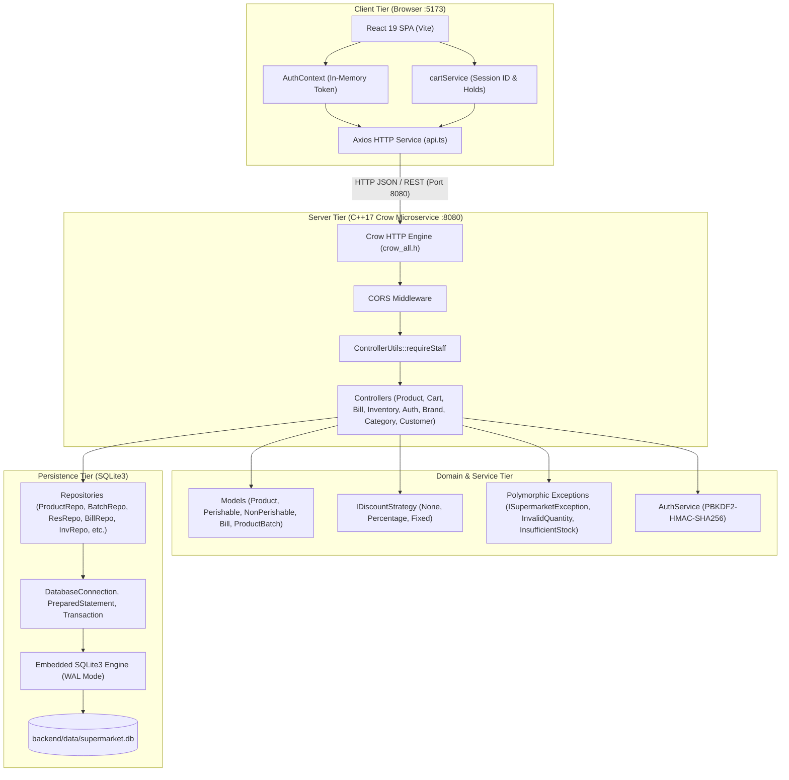
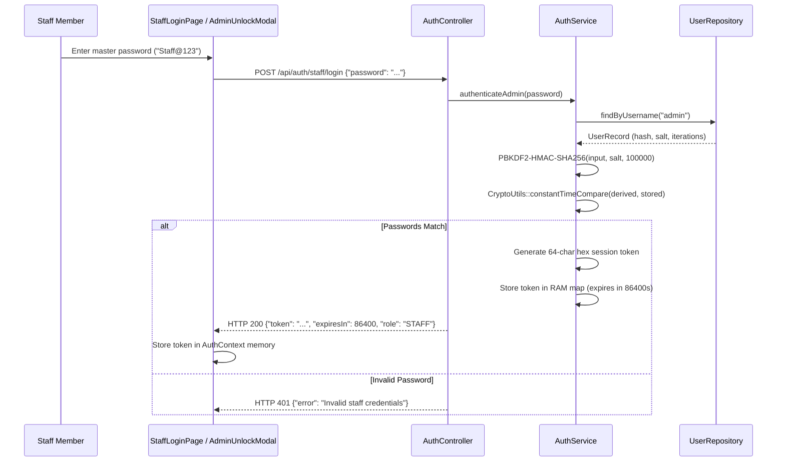

# Architecture Specification — Supermarket Management System (ApexMart)

## Table of Contents
- [1. Architectural Overview](#1-architectural-overview)
- [2. System Topology & Layers](#2-system-topology-layers)
- [3. Backend C++ Engine Architecture](#3-backend-c-engine-architecture)
- [4. Purchase Approval & Confirmation Flow (Atomic Model)](#4-purchase-approval--confirmation-flow-atomic-model)
- [5. Multi-Session Reserved Stock System](#5-multi-session-reserved-stock-system)
- [6. Polymorphic C++ OOP Exception Hierarchy](#6-polymorphic-c-oop-exception-hierarchy)
- [7. Inventory Management Enhancements & FEFO Pipeline](#7-inventory-management-enhancements--fefo-pipeline)
- [8. Repository & Database Interaction Pattern](#8-repository-database-interaction-pattern)
- [9. Authentication & Session Lifecycle](#9-authentication-session-lifecycle)
- [10. Frontend Architecture (React 19 + TypeScript + Vite)](#10-frontend-architecture-react-19--typescript--vite)
- [11. Concurrency & Transactional Safety](#11-concurrency--transactional-safety)

---

## 1. Architectural Overview

The Supermarket Billing & Inventory Management System follows a **decoupled client-server architecture**:
- **Presentation Layer:** A responsive Single-Page Application (SPA) built with React 19, TypeScript 5, Tailwind CSS 3, Lucide React icons, and Vite 6.
- **Application & API Layer:** A multithreaded RESTful microservice built in ISO C++17 utilizing the Crow web framework and Asio standalone networking.
- **Domain & Persistence Layer:** Domain-Driven Design (DDD) domain entities, Strategy pattern discount evaluators, polymorphic domain exceptions, RAII database wrappers, and an embedded SQLite3 engine operating in Write-Ahead Logging (WAL) mode.

---

## 2. System Topology & Layers



---

## 3. Backend C++ Engine Architecture

### 3.1 Domain Model Layer (`models/`)
- **`Product` (Abstract Base Class):** Declares pure virtual methods `isExpired()` and `getProductType()`. Enforces private encapsulation of price, stock, and promotional strategy.
- **`Perishable` & `NonPerishable`:** Concrete derived classes implementing lifecycle behavior. `Perishable` maintains an ISO-8601 expiry string and calculates active shelf validity.
- **`ProductBatch`:** Represents individual supplier delivery lots with `batchNumber`, `quantity`, and `expiryDate` for perishable items.
- **`Bill` & `BillItem`:** Aggregate root and value entities representing sales transactions. Items capture immutable snapshots of prices and discounts at the instant of purchase.
- **`StockInfo`:** Private nested component class managing stock units and boundary checks.

### 3.2 Strategy Design Pattern (`strategies/` & `models/Discount.hpp`)
Encapsulates promotional discount algorithms:
- `IDiscountStrategy` (Pure Abstract Interface): Declares `calculateDiscount(int64_t priceInPaise)` and `clone()`.
- `NoDiscount`: Default strategy (0 paise reduction).
- `PercentageDiscount`: Calculates fractional discounts rounded to nearest paisa with bounds check $[0.0\%, 100.0\%]$.
- `FixedAmountDiscount`: Flat cash reduction with non-negative check, capped so deduction never exceeds item price.
- **Clamping Guarantee:** Final unit prices are clamped at 0 paise, preventing negative billing totals.

---

## 4. Purchase Approval & Confirmation Flow (Atomic Model)

In supermarket and retail POS workflows, checkouts must operate with zero latency and high reliability:
- **No External Gateway Bottleneck:** The system does not depend on third-party payment gateways, external webhooks, or physical QR code scanners that introduce network latency or downtime.
- **No Manual Approval Bottleneck:** Checkouts do not stall waiting for administrative approval.
- **Atomic Execution:** When customer or staff clicks "Confirm & Pay" (`POST /api/bills`), the backend performs atomic purchase approval:
  1. Validates all line-item quantities ($q > 0$).
  2. Verifies availability against physical stock.
  3. Inserts invoice header snapshot into `bills`.
  4. Inserts item snapshots into `bill_items`.
  5. Deducts inventory from `products` and dispatches multi-batch deductions via **FEFO (First-Expired, First-Out)**.
  6. Logs `SALE` entries in `inventory_movements`.
  7. Clears any active reservation holds for `sessionId` in `product_reservations`.
  8. Commits the transaction atomically.

---

## 5. Multi-Session Reserved Stock System

### Problem Solved
Concurrent shoppers adding the same limited stock item to their carts cause race conditions and cart check-out failures.

### System Architecture
- **Table `product_reservations` (Migration v6):** Stores active holds with `session_id`, `product_id`, `quantity`, and `expires_at` (15-minute TTL).
- **Dynamic Formula:**
  $$\text{availableStock} = \max\bigl(0,\, \text{totalStock} - \text{reservedStock}\bigr)$$
- **API Endpoints:**
  - `POST /api/cart/reserve`: Reserves quantity; returns HTTP 409 Conflict if requested units exceed available stock.
  - `POST /api/cart/release`: Releases a specific item hold.
  - `POST /api/cart/clear`: Clears all holds for the session.
  - `GET /api/cart`: Returns active session holds with remaining TTL.
- **Atomic Cleanup:** Completing an invoice via `POST /api/bills` automatically releases all reservations linked to the session within the checkout database transaction.

---

## 6. Polymorphic C++ OOP Exception Hierarchy

The backend implements custom domain exceptions in `backend/include/utils/Exceptions.hpp`:

```text
                     std::exception
                      ▲          ▲
                      │          │
        std::logic_error        std::runtime_error       ISupermarketException
              ▲                        ▲                  (Abstract Interface)
              │                        │                  [virtual what() = 0]
      std::invalid_argument            │                           ▲
         ▲              ▲              │                           │
         │              │              │                           │
         │   ┌──────────┴──────────────┼───────────────────────────┤
         │   │                         │                           │
         │   │              SupermarketException ──────────────────┘
         │   │
         │   └────── InvalidDiscountException ─────────────────────┐
         │                                                         │
         └────────── InvalidQuantityException ─────────────────────┤
                                                                   │
                            InsufficientStockException ────────────┘
```

1. **`ISupermarketException`:** Pure virtual interface (`virtual const char* what() const noexcept = 0;`).
2. **`InvalidQuantityException`:** Inherits from `std::invalid_argument` and `ISupermarketException`. Thrown on $q \le 0$ or non-integer inputs.
3. **`InsufficientStockException`:** Inherits from `std::runtime_error` and `ISupermarketException`. Encapsulates `requested`, `available`, and `productName` with getters: `.getRequested()`, `.getAvailable()`, `.getProductName()`.
4. **`InvalidDiscountException`:** Inherits from `std::invalid_argument` and `ISupermarketException`. Thrown when discount percentages are outside $[0.0\%, 100.0\%]$ or fixed amounts are negative.

---

## 7. Inventory Management Enhancements & FEFO Pipeline

1. **Duplicate Item Restock Logic:**
   - In `POST /api/products`, the system checks for existing active items matching SKU and normalized name/category.
   - If matched, the system increments existing stock, logs an `ADDITION` movement, adds a batch if perishable, and returns HTTP 200 without creating duplicate database rows.
2. **Multi-Batch Tracking with FEFO (First-Expired, First-Out):**
   - Perishable items track individual batches with expiry dates in `product_batches`.
   - `ProductBatchRepository::deductStockFEFO()` automatically depletes batches with the nearest expiry dates first during checkouts.
   - Dynamically synchronizes `products.expiry_date` to reflect the nearest active batch.
3. **Daily Price & Discount Auditing:**
   - Updates via `PUT /api/products/<id>` record changes in `price_history`, capturing old/new prices, old/new discounts, notes, and timestamps.

---

## 8. Repository & Database Interaction Pattern

### RAII Classes (`database/`)
- **`DatabaseConnection`:** Wraps `sqlite3*`. Opens with `SQLITE_OPEN_READWRITE | SQLITE_OPEN_CREATE | SQLITE_OPEN_FULLMUTEX`. Configures `PRAGMA journal_mode = WAL` and `PRAGMA foreign_keys = ON`.
- **`PreparedStatement`:** Wraps `sqlite3_stmt*`. Handles argument binding (`bindInt`, `bindText`, `bindInt64`, `bindDouble`), execution (`step()`), and automated `sqlite3_finalize` in destructor.
- **`Transaction`:** Manages transactional state. Executes `BEGIN TRANSACTION` on construction and `COMMIT` on `commit()`. If destruction occurs while uncommitted (due to an exception), it automatically invokes `ROLLBACK`.

---

## 9. Authentication & Session Lifecycle



---

## 10. Frontend Architecture (React 19 + TypeScript + Vite)

The frontend is structured according to domain feature encapsulation:

```text
frontend/src/
├── components/          # Reusable presentation components
│   ├── admin/           # BrandManager, CategoryManager, CategoryBrandManager, CustomerManager
│   ├── auth/            # StaffProtectedRoute, AdminUnlockModal
│   ├── billing/         # POS Catalog, Cart, InvoiceReceiptModal, InvoiceDetailModal
│   ├── inventory/       # StockAdjustmentModal
│   ├── layout/          # Header, Sidebar, Layout wrapper, StatusBadge
│   ├── oop/             # ArchitectureDiagrams, ConceptQuiz, CppCodeBlock, InteractiveDemos
│   ├── products/        # ProductFormModal, ProductDeleteModal
│   └── ui/              # Button, Card, Badge, LoadingSpinner, EmptyState
├── context/             # Global application state
│   └── AuthContext.tsx  # In-memory staff session state & timer
├── pages/               # Route components
│   ├── HomePage.tsx     # Public corporate website & catalog
│   ├── DashboardPage.tsx# Operational KPI metrics & charts
│   ├── BillingPage.tsx  # High-speed POS Terminal
│   ├── ProductsPage.tsx # Product catalog & batch inspector
│   ├── InventoryPage.tsx# Stock monitoring & audit ledger
│   ├── TransactionsPage.tsx # Invoice audit register
│   ├── AnalyticsPage.tsx# Sales revenue & department breakdown
│   ├── AdminPage.tsx    # Staff & taxonomy management
│   ├── StaffLoginPage.tsx # Staff authentication portal
│   └── OopConceptsPage.tsx # Interactive academic OOP guide
├── services/            # Backend communication
│   ├── api.ts           # Axios instance with Authorization interceptors
│   ├── cartService.ts   # Multi-session cart holds & TTL handling
│   ├── productService.ts# Catalog and batch endpoints
│   ├── billService.ts   # Purchase checkout & invoices
│   └── inventoryService.ts # Stock adjustments & movements
├── styles/              # Global Tailwind CSS definitions
└── types/               # TypeScript data transfer contracts
```

---

## 11. Concurrency & Transactional Safety

1. **SQLite WAL Mode (`PRAGMA journal_mode = WAL`):** Enables non-blocking concurrent readers while write transactions execute.
2. **Serial Writes via SQLite Mutex:** Database connections use `SQLITE_OPEN_FULLMUTEX` ensuring thread-safe access across Crow worker threads.
3. **Atomic Stock Decrement:** In `BillRepository::saveBill`, stock validation, batch deduction via FEFO, invoice creation, and movement logging happen within the same transaction. If an error or exception occurs, stack unwinding automatically triggers `ROLLBACK`, ensuring shelf counts are never corrupted.
