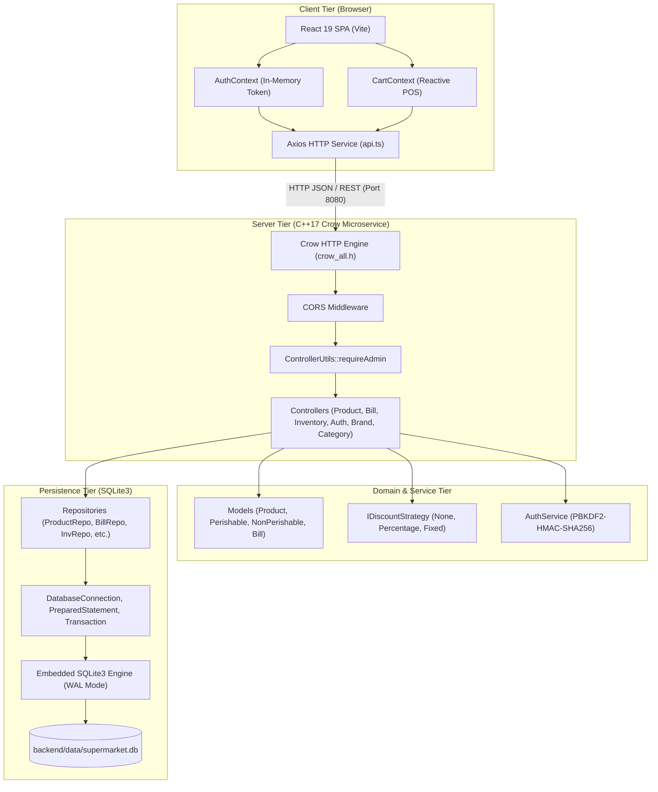
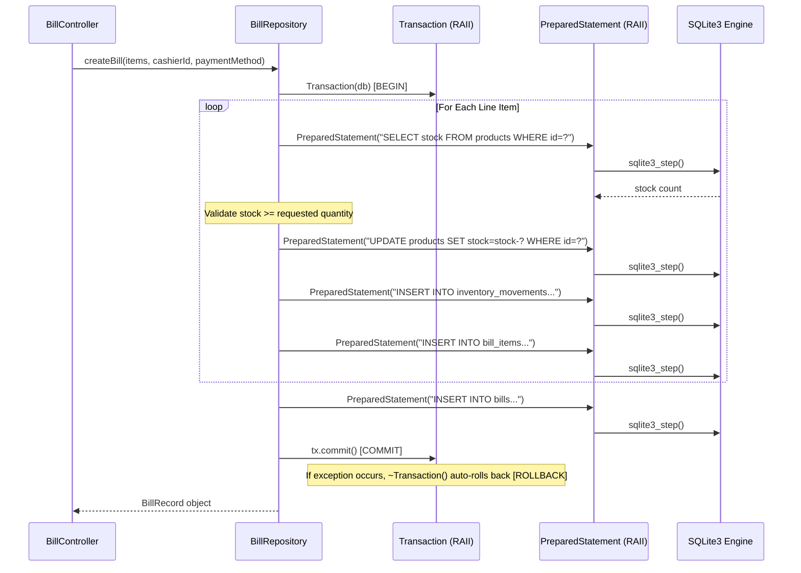
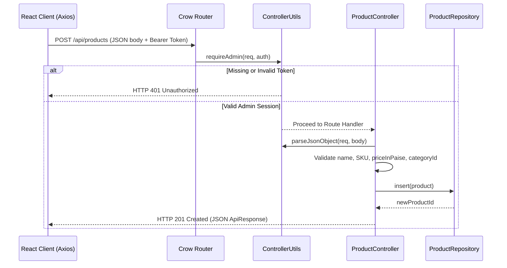
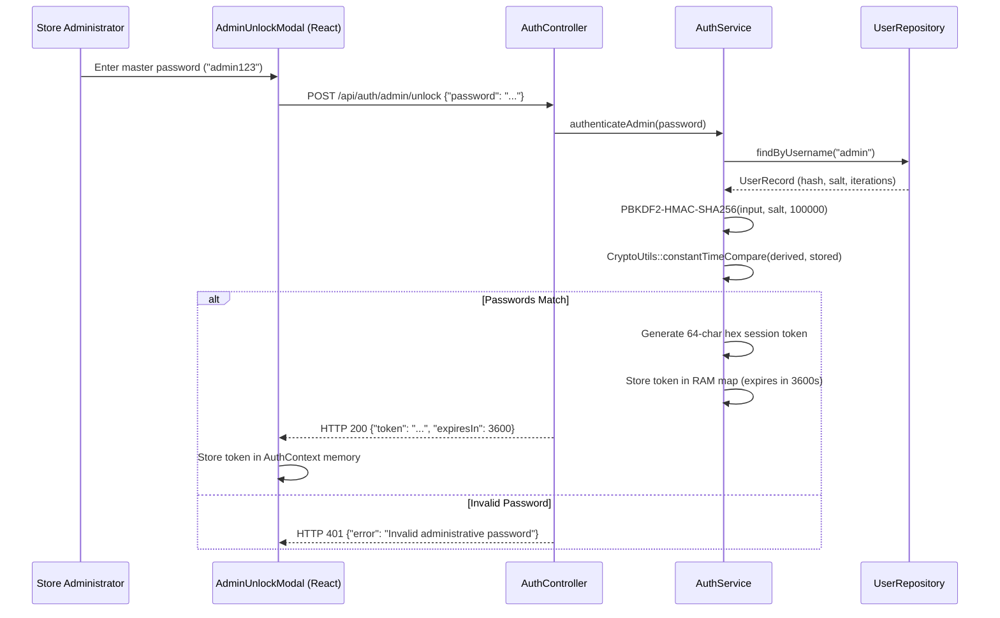

# Architecture Specification — Supermarket Management System

## Table of Contents
- [1. Architectural Overview](#1-architectural-overview)
- [2. System Topology & Layers](#2-system-topology-layers)
- [3. Backend C++ Engine Architecture](#3-backend-c-engine-architecture)
- [4. Repository & Database Interaction Pattern](#4-repository-database-interaction-pattern)
- [5. Request Lifecycle & Controller Responsibilities](#5-request-lifecycle-controller-responsibilities)
- [6. Authentication & Session Lifecycle](#6-authentication-session-lifecycle)
- [7. Frontend Architecture (React + Vite)](#7-frontend-architecture-react-vite)
- [8. Concurrency & Transactional Safety](#8-concurrency-transactional-safety)

---

## 1. Architectural Overview

The Supermarket Billing & Inventory Management System follows a **decoupled client-server architecture**:
- **Presentation Layer:** A single-page application (SPA) built with React 19, TypeScript, Tailwind CSS, and Vite.
- **Application & API Layer:** A multithreaded RESTful microservice built in C++17 utilizing the Crow web framework and Asio standalone networking.
- **Domain & Persistence Layer:** Domain-Driven Design (DDD) domain entities, Strategy pattern discount evaluators, RAII database wrappers, and an embedded SQLite3 engine operating in Write-Ahead Logging (WAL) mode.

---

## 2. System Topology & Layers



---

## 3. Backend C++ Engine Architecture

### Key Subsystems

1. **`server/` (`AppServer.hpp`, `ServerConfig.hpp`):**
   - Encapsulates the Crow HTTP daemon.
   - Binds to `HOST` (default `0.0.0.0`) and `PORT` (default `8080`).
   - Automatically resolves the canonical database path (`backend/data/supermarket.db`).
   - Registers all modular controller routes on startup.

2. **`auth/` (`AuthService.hpp`, `CryptoUtils.hpp`):**
   - Manages administrator credentials using PBKDF2-HMAC-SHA256 (100,000 iterations, 16-byte random salt).
   - Generates 64-character hexadecimal session tokens using cryptographically secure random bytes (`BCryptGenRandom` on Windows, `RAND_bytes` on Linux).
   - Implements constant-time memory comparisons to prevent timing attacks.

3. **`models/` & `strategies/`:**
   - Pure C++ domain entities enforcing business invariants.
   - `Product` encapsulates private `StockInfo`.
   - `Perishable` and `NonPerishable` inherit from `Product` with polymorphic virtual dispatch (`isExpired()`, `getProductType()`).
   - `IDiscountStrategy` defines the polymorphic contract for discount computations.

---

## 4. Repository & Database Interaction Pattern

The persistence layer isolates SQL query compilation and execution behind the **Repository Pattern**:



### RAII Classes (`database/`)
- **`DatabaseConnection`:** Wraps `sqlite3*`. Opens with `SQLITE_OPEN_READWRITE | SQLITE_OPEN_CREATE | SQLITE_OPEN_FULLMUTEX`. Configures `PRAGMA journal_mode = WAL` and `PRAGMA foreign_keys = ON`.
- **`PreparedStatement`:** Wraps `sqlite3_stmt*`. Handles argument binding (`bindInt`, `bindText`, `bindInt64`), execution (`step()`), and automated `sqlite3_finalize` in destructor.
- **`Transaction`:** Manages transactional state. Executes `BEGIN TRANSACTION` on construction and `COMMIT` on `commit()`. If destruction occurs while uncommitted (e.g., due to an uncaught domain exception), it automatically invokes `ROLLBACK`.

---

## 5. Request Lifecycle & Controller Responsibilities



---

## 6. Authentication & Session Lifecycle



---

## 7. Frontend Architecture (React + Vite)

The frontend is structured according to domain feature encapsulation:

```text
frontend/src/
├── components/          # Reusable presentation components
│   ├── auth/            # AdminUnlockModal
│   ├── billing/         # POS Catalog, Cart, InvoiceReceiptModal
│   ├── common/          # ErrorBoundary, ConfirmationModal
│   ├── layout/          # Header, Sidebar, Layout wrapper
│   └── ui/              # Button, Card, Badge, Table primitives
├── context/             # Global application state
│   ├── AuthContext.tsx  # In-memory admin session state & timer
│   └── CartContext.tsx  # POS cart line items, calculations, discounts
├── pages/               # Route components
│   ├── HomePage.tsx     # Public corporate website (ApexMart)
│   ├── DashboardPage.tsx
│   ├── BillingPage.tsx  # POS Terminal
│   ├── ProductsPage.tsx
│   ├── InventoryPage.tsx
│   ├── TransactionsPage.tsx
│   ├── AnalyticsPage.tsx
│   ├── AdminPage.tsx
│   └── OopConceptsPage.tsx
├── services/            # Backend communication
│   └── api.ts           # Axios instance with Authorization interceptors
├── styles/              # Global Tailwind CSS definitions
└── types/               # TypeScript data transfer contracts
```

---

## 8. Concurrency & Transactional Safety

1. **SQLite WAL Mode (`PRAGMA journal_mode = WAL`):** Enables non-blocking concurrent readers while a write transaction executes.
2. **Serial Writes via SQLite Mutex:** Database connections use `SQLITE_OPEN_FULLMUTEX` ensuring thread-safe access from Crow's worker thread pool.
3. **Atomic Stock Decrement:** In `BillRepository::createBill`, stock validation and deduction happen inside the same transaction as invoice creation. If any line item has insufficient stock, the transaction aborts and rolls back completely, ensuring shelf counts are never corrupted.
