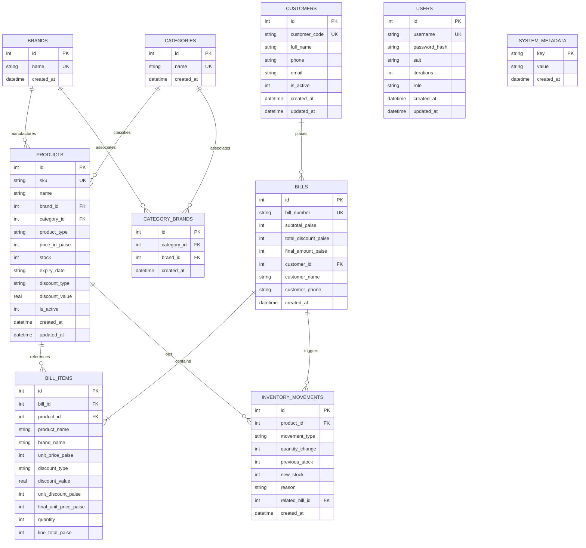

# Database Design: Supermarket Billing & Inventory Management System

**Storage Engine:** Embedded SQLite 3.46.1
**Canonical File Path:** `backend/data/supermarket.db`
**Concurrency Mode:** Write-Ahead Logging (WAL) (`PRAGMA journal_mode = WAL;`)
**Integrity Pragma:** Foreign Key Constraints Enforced (`PRAGMA foreign_keys = ON;`)
**Currency Invariant:** Integer Paise Storage (`int64_t`, $1\text{ INR} = 100\text{ paise}$)

---

## 1. Entity-Relationship Diagram (ERD)



---

## 2. Table Schemas & Data Dictionaries

### 2.1 `brands`
Stores manufacturer and brand labels.
| Column | Type | Constraints | Description |
| :--- | :--- | :--- | :--- |
| `id` | `INTEGER` | `PRIMARY KEY AUTOINCREMENT` | Unique brand identifier |
| `name` | `TEXT` | `NOT NULL UNIQUE` | Brand name (e.g., Amul, Tata, Aashirvaad) |
| `created_at` | `DATETIME` | `DEFAULT CURRENT_TIMESTAMP` | Record creation timestamp |

### 2.2 `categories`
Stores product taxonomy and store departments.
| Column | Type | Constraints | Description |
| :--- | :--- | :--- | :--- |
| `id` | `INTEGER` | `PRIMARY KEY AUTOINCREMENT` | Unique category identifier |
| `name` | `TEXT` | `NOT NULL UNIQUE` | Category title (e.g., Dairy, Grains, Personal Care) |
| `created_at` | `DATETIME` | `DEFAULT CURRENT_TIMESTAMP` | Record creation timestamp |

### 2.3 `category_brands` (Junction Table)
Defines authorized relationships between retail categories and brand manufacturers.
| Column | Type | Constraints | Description |
| :--- | :--- | :--- | :--- |
| `id` | `INTEGER` | `PRIMARY KEY AUTOINCREMENT` | Unique junction entry ID |
| `category_id` | `INTEGER` | `NOT NULL, FK -> categories(id) ON DELETE CASCADE` | Associated category |
| `brand_id` | `INTEGER` | `NOT NULL, FK -> brands(id) ON DELETE CASCADE` | Associated brand |
| `created_at` | `DATETIME` | `DEFAULT CURRENT_TIMESTAMP` | Association timestamp |
| *Constraint* | `UNIQUE` | `UNIQUE(category_id, brand_id)` | Prevents duplicate category-brand links |

### 2.4 `products`
Master store catalog containing current inventory counts and retail pricing.
| Column | Type | Constraints | Description |
| :--- | :--- | :--- | :--- |
| `id` | `INTEGER` | `PRIMARY KEY AUTOINCREMENT` | Unique product identifier |
| `sku` | `TEXT` | `NOT NULL UNIQUE` | Stock Keeping Unit / Barcode code |
| `name` | `TEXT` | `NOT NULL` | Full commercial product name |
| `brand_id` | `INTEGER` | `NOT NULL, FK -> brands(id) ON DELETE RESTRICT` | Manufacturer reference |
| `category_id` | `INTEGER` | `NOT NULL, FK -> categories(id) ON DELETE RESTRICT` | Department reference |
| `product_type` | `TEXT` | `NOT NULL CHECK (product_type IN ('PERISHABLE', 'NON_PERISHABLE'))` | Lifecycle classification |
| `price_in_paise` | `INTEGER` | `NOT NULL CHECK (price_in_paise >= 0)` | Retail shelf price in paise |
| `stock` | `INTEGER` | `NOT NULL DEFAULT 0 CHECK (stock >= 0)` | On-shelf quantity available |
| `expiry_date` | `TEXT` | `NULLABLE` | ISO-8601 expiry date string (for perishables) |
| `discount_type` | `TEXT` | `NOT NULL CHECK (discount_type IN ('NONE', 'PERCENTAGE', 'FIXED'))` | Active promotion algorithm |
| `discount_value` | `REAL` | `NOT NULL DEFAULT 0.0 CHECK (discount_value >= 0)` | Discount rate (% or paise amount) |
| `is_active` | `INTEGER` | `NOT NULL DEFAULT 1 CHECK (is_active IN (0, 1))` | Soft deletion visibility toggle |
| `created_at` | `DATETIME` | `DEFAULT CURRENT_TIMESTAMP` | Creation timestamp |
| `updated_at` | `DATETIME` | `DEFAULT CURRENT_TIMESTAMP` | Last modification timestamp |

### 2.5 `customers`
Customer directory for optional CRM and loyalty checkout linking.
| Column | Type | Constraints | Description |
| :--- | :--- | :--- | :--- |
| `id` | `INTEGER` | `PRIMARY KEY AUTOINCREMENT` | Unique customer identifier |
| `customer_code` | `TEXT` | `NOT NULL UNIQUE` | Customer loyalty barcode/code |
| `full_name` | `TEXT` | `NOT NULL` | Customer name |
| `phone` | `TEXT` | `NULLABLE` | Contact telephone number |
| `email` | `TEXT` | `NULLABLE` | Customer email address |
| `is_active` | `INTEGER` | `NOT NULL DEFAULT 1 CHECK (is_active IN (0, 1))` | Active membership status |
| `created_at` | `DATETIME` | `DEFAULT CURRENT_TIMESTAMP` | Registration timestamp |
| `updated_at` | `DATETIME` | `DEFAULT CURRENT_TIMESTAMP` | Profile update timestamp |

### 2.6 `bills` (Sales Invoices)
Header record for completed customer transactions.
| Column | Type | Constraints | Description |
| :--- | :--- | :--- | :--- |
| `id` | `INTEGER` | `PRIMARY KEY AUTOINCREMENT` | Unique database bill ID |
| `bill_number` | `TEXT` | `NOT NULL UNIQUE` | Human-readable bill reference (e.g., `BILL-20261118-001`) |
| `subtotal_paise` | `INTEGER` | `NOT NULL CHECK (subtotal_paise >= 0)` | Gross sum of items before discounts |
| `total_discount_paise` | `INTEGER` | `NOT NULL CHECK (total_discount_paise >= 0)` | Total promotional savings |
| `final_amount_paise` | `INTEGER` | `NOT NULL CHECK (final_amount_paise >= 0)` | Net payable amount in paise |
| `customer_id` | `INTEGER` | `NULLABLE, FK -> customers(id) ON DELETE SET NULL` | Linked customer reference |
| `customer_name` | `TEXT` | `NULLABLE` | Snapshot of customer name at checkout |
| `customer_phone` | `TEXT` | `NULLABLE` | Snapshot of customer phone at checkout |
| `created_at` | `DATETIME` | `DEFAULT CURRENT_TIMESTAMP` | Transaction timestamp |

### 2.7 `bill_items` (Historical Invoice Snapshots)
Itemized lines of a bill. **Critical Architecture Rule:** This table snapshots product details at the exact moment of purchase so that future catalog changes (e.g. price hikes or product renaming) never modify historical invoices.
| Column | Type | Constraints | Description |
| :--- | :--- | :--- | :--- |
| `id` | `INTEGER` | `PRIMARY KEY AUTOINCREMENT` | Line item unique ID |
| `bill_id` | `INTEGER` | `NOT NULL, FK -> bills(id) ON DELETE CASCADE` | Associated invoice |
| `product_id` | `INTEGER` | `NULLABLE, FK -> products(id) ON DELETE SET NULL` | Reference to product (survives product deletion) |
| `product_name` | `TEXT` | `NOT NULL` | Historical name snapshot |
| `brand_name` | `TEXT` | `NOT NULL` | Historical brand name snapshot |
| `unit_price_paise` | `INTEGER` | `NOT NULL` | Unit price at purchase time |
| `discount_type` | `TEXT` | `NOT NULL` | Applied discount strategy type |
| `discount_value` | `REAL` | `NOT NULL` | Applied discount rate/value |
| `unit_discount_paise` | `INTEGER` | `NOT NULL` | Unit discount amount in paise |
| `final_unit_price_paise` | `INTEGER` | `NOT NULL` | Net unit price paid |
| `quantity` | `INTEGER` | `NOT NULL CHECK (quantity > 0)` | Units purchased |
| `line_total_paise` | `INTEGER` | `NOT NULL CHECK (line_total_paise >= 0)` | Net line total ($\text{final unit price} \times \text{quantity}$) |

### 2.8 `inventory_movements` (Immutable Audit Ledger)
Append-only log recording every stock change in the supermarket.
| Column | Type | Constraints | Description |
| :--- | :--- | :--- | :--- |
| `id` | `INTEGER` | `PRIMARY KEY AUTOINCREMENT` | Unique movement entry ID |
| `product_id` | `INTEGER` | `NOT NULL, FK -> products(id) ON DELETE RESTRICT` | Affected product |
| `movement_type` | `TEXT` | `NOT NULL CHECK (movement_type IN ('ADDITION', 'REDUCTION', 'SALE', 'ADJUSTMENT'))` | Movement category |
| `quantity_change` | `INTEGER` | `NOT NULL` | Delta (positive for intake, negative for sale/loss) |
| `previous_stock` | `INTEGER` | `NOT NULL` | Stock balance before movement |
| `new_stock` | `INTEGER` | `NOT NULL` | Stock balance after movement |
| `reason` | `TEXT` | `NULLABLE` | Audit justification (e.g., "Customer Sale BILL-...", "Damaged stock write-off") |
| `related_bill_id` | `INTEGER` | `NULLABLE, FK -> bills(id) ON DELETE SET NULL` | Linked checkout invoice |
| `created_at` | `DATETIME` | `DEFAULT CURRENT_TIMESTAMP` | Audit log timestamp |

### 2.9 `users` (Staff Credentials)
Stores staff authentication records.
| Column | Type | Constraints | Description |
| :--- | :--- | :--- | :--- |
| `id` | `INTEGER` | `PRIMARY KEY AUTOINCREMENT` | Unique user ID |
| `username` | `TEXT` | `NOT NULL UNIQUE` | Staff account username |
| `password_hash` | `TEXT` | `NOT NULL` | PBKDF2-HMAC-SHA256 digest string |
| `salt` | `TEXT` | `NOT NULL` | 128-bit cryptographically random salt |
| `iterations` | `INTEGER` | `NOT NULL DEFAULT 100000` | PBKDF2 iteration cost parameter |
| `role` | `TEXT` | `NOT NULL CHECK (role IN ('ADMIN', 'STAFF'))` | Operating role (`STAFF`) |
| `created_at` | `DATETIME` | `DEFAULT CURRENT_TIMESTAMP` | Account creation timestamp |
| `updated_at` | `DATETIME` | `DEFAULT CURRENT_TIMESTAMP` | Account modification timestamp |

### 2.10 `system_metadata`
Key-value store for application runtime metadata and seeder idempotency tracking.
| Column | Type | Constraints | Description |
| :--- | :--- | :--- | :--- |
| `key` | `TEXT` | `PRIMARY KEY` | Metadata configuration key |
| `value` | `TEXT` | `NOT NULL` | Metadata value payload |
| `created_at` | `DATETIME` | `DEFAULT CURRENT_TIMESTAMP` | Creation timestamp |

---

## 3. Database Migrations (`DatabaseMigrator`)

The system implements an automated forward migration system in `backend/src/database/DatabaseMigrator.cpp`. It reads SQLite's internal version register via `PRAGMA user_version`:

- **Version 0 $\rightarrow$ 1:** Baseline schema (`brands`, `categories`, `products`, `bills`, `bill_items`, `inventory_movements`, indexes).
- **Version 1 $\rightarrow$ 2:** Security schema (`users` table with PBKDF2 hash, salt, and iterations).
- **Version 2 $\rightarrow$ 3:** CRM and metadata (`customers` table, customer columns in `bills`, `system_metadata`).
- **Version 3 $\rightarrow$ 4:** Taxonomy relations (`category_brands` junction table, seeded relations).

Migrations execute within an explicit `Transaction` object; if any DDL statement fails, the database automatically rolls back and the `PRAGMA user_version` remains unchanged.

---

## 4. ACID Transaction Safety

The checkout operation in `BillingService::createBill()` executes inside a strict SQLite transaction:
```cpp
Transaction tx(dbConnection);

// 1. Verify and lock product rows
for (const auto& item : requestedItems) {
    auto product = productRepo.findById(item.productId);
    if (!product || product->getStock() < item.quantity) {
        throw InsufficientStockException("Insufficient stock for " + product->getName());
        // RAII: tx destructor automatically issues 'ROLLBACK;'
    }
}

// 2. Insert into bills
int64_t billId = billRepo.insert(billHeader);

// 3. Insert bill items and decrement inventory
for (const auto& item : calculatedItems) {
    billRepo.insertItem(billId, item);
    productRepo.decrementStock(item.productId, item.quantity);
    inventoryRepo.logMovement(item.productId, "SALE", -item.quantity, ...);
}

// 4. Commit transaction
tx.commit(); // Issues 'COMMIT;'
```
If an exception is thrown at any point prior to `tx.commit()`, the RAII destructor of `Transaction` guarantees that the database is rolled back to its pre-checkout state.
