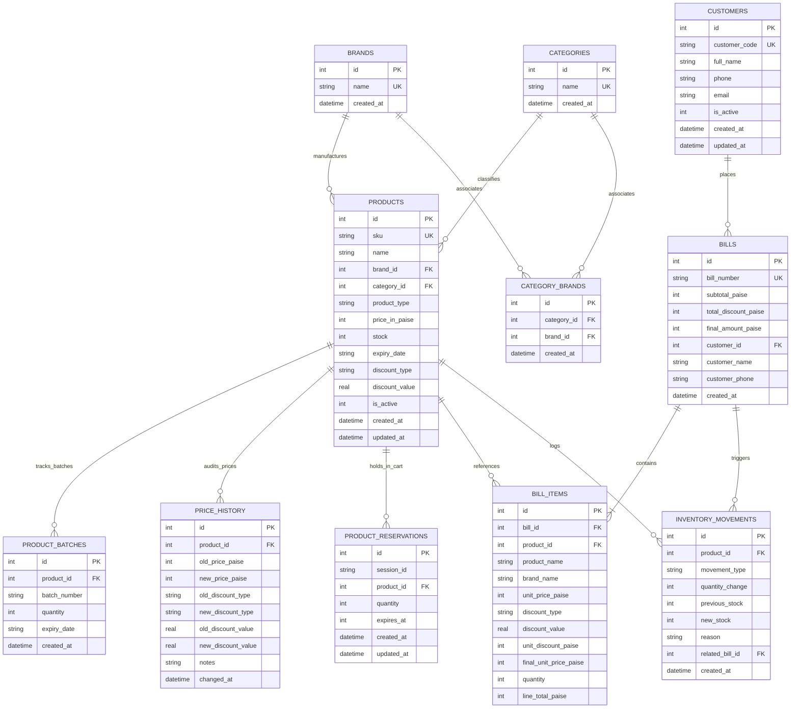

# Database Design: Supermarket Billing & Inventory Management System (ApexMart)

**Storage Engine:** Embedded SQLite 3.46.1  
**Canonical File Path:** `backend/data/supermarket.db`  
**Concurrency Mode:** Write-Ahead Logging (WAL) (`PRAGMA journal_mode = WAL;`)  
**Integrity Pragma:** Foreign Key Constraints Enforced (`PRAGMA foreign_keys = ON;`)  
**Currency Invariant:** Integer Paise Storage (`int64_t`, $1\text{ INR} = 100\text{ paise}$)  
**Current Schema Migration Version:** `PRAGMA user_version = 6;`

---

## 1. Entity-Relationship Diagram (ERD)



---

## 2. Relational Schema Specification

### 2.1 `brands`
| Column | Type | Constraints | Description |
| :--- | :--- | :--- | :--- |
| `id` | `INTEGER` | `PRIMARY KEY AUTOINCREMENT` | Unique brand identifier |
| `name` | `TEXT` | `NOT NULL UNIQUE` | Manufacturer / brand name |
| `created_at` | `DATETIME` | `DEFAULT CURRENT_TIMESTAMP` | Timestamp of creation |

### 2.2 `categories`
| Column | Type | Constraints | Description |
| :--- | :--- | :--- | :--- |
| `id` | `INTEGER` | `PRIMARY KEY AUTOINCREMENT` | Unique category identifier |
| `name` | `TEXT` | `NOT NULL UNIQUE` | Store department name |
| `created_at` | `DATETIME` | `DEFAULT CURRENT_TIMESTAMP` | Timestamp of creation |

### 2.3 `category_brands` (Junction Table)
| Column | Type | Constraints | Description |
| :--- | :--- | :--- | :--- |
| `id` | `INTEGER` | `PRIMARY KEY AUTOINCREMENT` | Unique junction entry ID |
| `category_id` | `INTEGER` | `NOT NULL, FK -> categories(id) ON DELETE CASCADE` | Associated category |
| `brand_id` | `INTEGER` | `NOT NULL, FK -> brands(id) ON DELETE CASCADE` | Associated brand |
| `created_at` | `DATETIME` | `DEFAULT CURRENT_TIMESTAMP` | Association timestamp |
| *Constraint* | `UNIQUE` | `UNIQUE(category_id, brand_id)` | Prevents duplicate links |

### 2.4 `products`
Master store catalog containing current total stock counts and pricing.
| Column | Type | Constraints | Description |
| :--- | :--- | :--- | :--- |
| `id` | `INTEGER` | `PRIMARY KEY AUTOINCREMENT` | Unique product identifier |
| `sku` | `TEXT` | `NOT NULL UNIQUE` | Stock Keeping Unit / Barcode code |
| `name` | `TEXT` | `NOT NULL` | Full commercial product name |
| `brand_id` | `INTEGER` | `NOT NULL, FK -> brands(id) ON DELETE RESTRICT` | Manufacturer reference |
| `category_id` | `INTEGER` | `NOT NULL, FK -> categories(id) ON DELETE RESTRICT` | Department reference |
| `product_type` | `TEXT` | `NOT NULL CHECK (product_type IN ('PERISHABLE', 'NON_PERISHABLE'))` | Classification |
| `price_in_paise` | `INTEGER` | `NOT NULL CHECK (price_in_paise >= 0)` | Shelf price in paise |
| `stock` | `INTEGER` | `NOT NULL DEFAULT 0 CHECK (stock >= 0)` | Total physical inventory |
| `expiry_date` | `TEXT` | `NULLABLE` | Nearest expiry date (YYYY-MM-DD) |
| `discount_type` | `TEXT` | `NOT NULL CHECK (discount_type IN ('NONE', 'PERCENTAGE', 'FIXED'))` | Active promotion type |
| `discount_value` | `REAL` | `NOT NULL DEFAULT 0.0 CHECK (discount_value >= 0)` | Discount rate (% or rupees) |
| `is_active` | `INTEGER` | `NOT NULL DEFAULT 1 CHECK (is_active IN (0, 1))` | Soft deletion flag |
| `created_at` | `DATETIME` | `DEFAULT CURRENT_TIMESTAMP` | Creation timestamp |
| `updated_at` | `DATETIME` | `DEFAULT CURRENT_TIMESTAMP` | Modification timestamp |

### 2.5 `product_batches` (FEFO Inventory Batches - Migration v5)
Tracks individual delivery batches for perishable products. Used for First-Expired, First-Out (FEFO) stock deduction.
| Column | Type | Constraints | Description |
| :--- | :--- | :--- | :--- |
| `id` | `INTEGER` | `PRIMARY KEY AUTOINCREMENT` | Unique batch identifier |
| `product_id` | `INTEGER` | `NOT NULL, FK -> products(id) ON DELETE CASCADE` | Associated perishable product |
| `batch_number` | `TEXT` | `NOT NULL` | Supplier batch number / identifier |
| `quantity` | `INTEGER` | `NOT NULL CHECK (quantity >= 0)` | Quantity remaining in this batch |
| `expiry_date` | `TEXT` | `NOT NULL` | Expiry date string (YYYY-MM-DD) |
| `created_at` | `DATETIME` | `DEFAULT CURRENT_TIMESTAMP` | Intake timestamp |
| *Index* | `INDEX` | `idx_batches_product (product_id)` | Fast lookup by product |
| *Index* | `INDEX` | `idx_batches_expiry (expiry_date)` | Fast sorting for FEFO deduction |

### 2.6 `price_history` (Price & Discount Audit Trail - Migration v5)
Tracks every historical price and discount modification performed by staff.
| Column | Type | Constraints | Description |
| :--- | :--- | :--- | :--- |
| `id` | `INTEGER` | `PRIMARY KEY AUTOINCREMENT` | Unique history record ID |
| `product_id` | `INTEGER` | `NOT NULL, FK -> products(id) ON DELETE CASCADE` | Associated product |
| `old_price_paise` | `INTEGER` | `NOT NULL` | Base price before change |
| `new_price_paise` | `INTEGER` | `NOT NULL` | Base price after change |
| `old_discount_type` | `TEXT` | `NOT NULL` | Previous discount strategy |
| `new_discount_type` | `TEXT` | `NOT NULL` | Updated discount strategy |
| `old_discount_value` | `REAL` | `NOT NULL` | Previous discount value |
| `new_discount_value` | `REAL` | `NOT NULL` | Updated discount value |
| `notes` | `TEXT` | `NULLABLE` | Audit justification notes |
| `changed_at` | `DATETIME` | `DEFAULT CURRENT_TIMESTAMP` | Modification timestamp |
| *Index* | `INDEX` | `idx_price_history_product (product_id)` | Fast lookup by product |
| *Index* | `INDEX` | `idx_price_history_time (changed_at)` | Fast sorting for audit queries |

### 2.7 `product_reservations` (Multi-Session Cart Holds - Migration v6)
Maintains active cart reservations per session with a 15-minute Time-To-Live (TTL).
| Column | Type | Constraints | Description |
| :--- | :--- | :--- | :--- |
| `id` | `INTEGER` | `PRIMARY KEY AUTOINCREMENT` | Unique reservation ID |
| `session_id` | `TEXT` | `NOT NULL` | Frontend browser cart session token |
| `product_id` | `INTEGER` | `NOT NULL, FK -> products(id) ON DELETE CASCADE` | Target product |
| `quantity` | `INTEGER` | `NOT NULL CHECK (quantity > 0)` | Reserved units held |
| `expires_at` | `INTEGER` | `NOT NULL` | Unix epoch expiration timestamp |
| `created_at` | `DATETIME` | `DEFAULT CURRENT_TIMESTAMP` | Initial reservation timestamp |
| `updated_at` | `DATETIME` | `DEFAULT CURRENT_TIMESTAMP` | Last quantity update timestamp |
| *Constraint* | `UNIQUE` | `UNIQUE(session_id, product_id)` | One reservation entry per product per session |
| *Index* | `INDEX` | `idx_reservations_session (session_id)` | Fast lookup by session |
| *Index* | `INDEX` | `idx_reservations_product (product_id)` | Fast calculation of reserved stock |
| *Index* | `INDEX` | `idx_reservations_expires (expires_at)` | Fast TTL expiration cleanup |

### 2.8 `bills` (Sales Invoices)
Header record for completed customer transactions.
| Column | Type | Constraints | Description |
| :--- | :--- | :--- | :--- |
| `id` | `INTEGER` | `PRIMARY KEY AUTOINCREMENT` | Unique database bill ID |
| `bill_number` | `TEXT` | `NOT NULL UNIQUE` | Invoice code (e.g., `INV-20261118023045-812-001`) |
| `subtotal_paise` | `INTEGER` | `NOT NULL CHECK (subtotal_paise >= 0)` | Gross sum before discounts |
| `total_discount_paise` | `INTEGER` | `NOT NULL CHECK (total_discount_paise >= 0)` | Promotional savings |
| `final_amount_paise` | `INTEGER` | `NOT NULL CHECK (final_amount_paise >= 0)` | Net payable amount in paise |
| `customer_id` | `INTEGER` | `NULLABLE, FK -> customers(id) ON DELETE SET NULL` | Linked customer reference |
| `customer_name` | `TEXT` | `NULLABLE` | Snapshot of customer name at checkout |
| `customer_phone` | `TEXT` | `NULLABLE` | Snapshot of customer phone at checkout |
| `created_at` | `DATETIME` | `DEFAULT CURRENT_TIMESTAMP` | Transaction timestamp |

### 2.9 `bill_items` (Historical Invoice Snapshots)
Itemized lines of an invoice. Snapshot guarantees that subsequent price changes never alter past sales records.
| Column | Type | Constraints | Description |
| :--- | :--- | :--- | :--- |
| `id` | `INTEGER` | `PRIMARY KEY AUTOINCREMENT` | Line item unique ID |
| `bill_id` | `INTEGER` | `NOT NULL, FK -> bills(id) ON DELETE CASCADE` | Associated invoice |
| `product_id` | `INTEGER` | `NULLABLE, FK -> products(id) ON DELETE SET NULL` | Reference to product |
| `product_name` | `TEXT` | `NOT NULL` | Historical product name snapshot |
| `brand_name` | `TEXT` | `NOT NULL` | Historical brand name snapshot |
| `unit_price_paise` | `INTEGER` | `NOT NULL` | Unit price at purchase time |
| `discount_type` | `TEXT` | `NOT NULL` | Applied discount strategy type |
| `discount_value` | `REAL` | `NOT NULL` | Applied discount rate/value |
| `unit_discount_paise` | `INTEGER` | `NOT NULL` | Unit discount in paise |
| `final_unit_price_paise` | `INTEGER` | `NOT NULL` | Net unit price paid |
| `quantity` | `INTEGER` | `NOT NULL CHECK (quantity > 0)` | Units purchased |
| `line_total_paise` | `INTEGER` | `NOT NULL CHECK (line_total_paise >= 0)` | Net line total |

### 2.10 `inventory_movements` (Immutable Audit Ledger)
Append-only log recording every stock change in the supermarket.
| Column | Type | Constraints | Description |
| :--- | :--- | :--- | :--- |
| `id` | `INTEGER` | `PRIMARY KEY AUTOINCREMENT` | Unique movement entry ID |
| `product_id` | `INTEGER` | `NOT NULL, FK -> products(id) ON DELETE RESTRICT` | Affected product |
| `movement_type` | `TEXT` | `NOT NULL CHECK (movement_type IN ('ADDITION', 'REDUCTION', 'SALE', 'ADJUSTMENT'))` | Movement category |
| `quantity_change` | `INTEGER` | `NOT NULL` | Delta (+ for intake, - for sale/loss) |
| `previous_stock` | `INTEGER` | `NOT NULL` | Stock balance before movement |
| `new_stock` | `INTEGER` | `NOT NULL` | Stock balance after movement |
| `reason` | `TEXT` | `NULLABLE` | Audit explanation |
| `related_bill_id` | `INTEGER` | `NULLABLE, FK -> bills(id) ON DELETE SET NULL` | Linked checkout invoice |
| `created_at` | `DATETIME` | `DEFAULT CURRENT_TIMESTAMP` | Audit log timestamp |

### 2.11 `users` (Staff Credentials)
Stores staff authentication records.
| Column | Type | Constraints | Description |
| :--- | :--- | :--- | :--- |
| `id` | `INTEGER` | `PRIMARY KEY AUTOINCREMENT` | Unique user ID |
| `username` | `TEXT` | `NOT NULL UNIQUE` | Staff account username |
| `password_hash` | `TEXT` | `NOT NULL` | PBKDF2-HMAC-SHA256 digest string |
| `salt` | `TEXT` | `NOT NULL` | 128-bit cryptographically random salt |
| `iterations` | `INTEGER` | `NOT NULL DEFAULT 100000` | PBKDF2 iteration cost |
| `role` | `TEXT` | `NOT NULL CHECK (role IN ('ADMIN', 'STAFF'))` | Operating role (`STAFF`) |
| `created_at` | `DATETIME` | `DEFAULT CURRENT_TIMESTAMP` | Account creation timestamp |
| `updated_at` | `DATETIME` | `DEFAULT CURRENT_TIMESTAMP` | Account modification timestamp |

---

## 3. Database Migrations (`DatabaseMigrator`)

The system implements automated, transactional forward migrations in `backend/src/database/DatabaseMigrator.cpp` tracked via SQLite's `PRAGMA user_version`:

- **Version 0 $\rightarrow$ 1:** Baseline schema (`brands`, `categories`, `products`, `bills`, `bill_items`, `inventory_movements`, indexes).
- **Version 1 $\rightarrow$ 2:** Security schema (`users` table with PBKDF2 hash, salt, and iterations).
- **Version 2 $\rightarrow$ 3:** CRM and metadata (`customers` table, customer columns in `bills`, `system_metadata`).
- **Version 3 $\rightarrow$ 4:** Taxonomy relations (`category_brands` junction table, seeded relations).
- **Version 4 $\rightarrow$ 5:** Multi-batch inventory tracking (`product_batches` table with FEFO indexes) and price modification auditing (`price_history` table).
- **Version 5 $\rightarrow$ 6:** Multi-session cart stock reservations (`product_reservations` table with TTL index).

Migrations execute inside an explicit `Transaction` object. If any DDL statement fails, SQLite rolls back the entire migration transaction and `PRAGMA user_version` remains untouched.

---

## 4. Multi-Session Reserved Stock System Architecture

### Problem Solved
In a retail supermarket or multi-user web POS, concurrent shoppers may add the same limited stock item to their carts simultaneously. Without reservation holds:
1. Shoppers face race conditions where items appear in stock, but checkout fails at the final moment.
2. Uncoordinated concurrent checkouts can cause negative inventory balances.

### Architecture & Mechanics
1. **Cart Hold Insertion:** Calling `POST /api/cart/reserve` inserts or updates a row in `product_reservations` with a 15-minute TTL (`expires_at = now + 900`).
2. **Dynamic Stock Calculation:**
   $$\text{reservedStock} = \sum_{\text{unexpired}} \text{quantity}$$
   $$\text{availableStock} = \max\bigl(0,\, \text{totalStock} - \text{reservedStock}\bigr)$$
3. **Atomic Expiration & Checkout Clearance:**
   - When a session completes purchase checkout via `POST /api/bills`, `ProductReservationRepository::clearSession(sessionId)` removes the session's holds atomically in the same database transaction.
   - Any stale reservations whose `expires_at < current_timestamp` are automatically pruned by background queries.

---

## 5. ACID Transaction Safety & FEFO Stock Deduction

The checkout operation in `BillRepository::saveBill()` executes inside a strict SQLite transaction (`Transaction tx(db);`):

```cpp
Transaction tx(db);

// 1. Verify availability across all requested items
for (const auto& [prodId, totalRequested] : requestedByProduct) {
    PreparedStatement checkStmt(db, "SELECT stock, name, is_active FROM products WHERE id = ?;");
    checkStmt.bind(1, prodId);
    checkStmt.step();
    int currentStock = checkStmt.getInt(0);
    std::string prodName = checkStmt.getString(1);

    if (currentStock < totalRequested) {
        throw InsufficientStockException(totalRequested, currentStock, prodName);
    }
}

// 2. Insert invoice header snapshot into bills
PreparedStatement billStmt(db, "INSERT INTO bills (...) VALUES (...);");
billStmt.execute();
int billId = db.getLastInsertRowId();

// 3. Insert bill_items, deduct product stock, and execute FEFO batch deduction
for (const auto& item : bill.getItems()) {
    // Deduct physical inventory
    repo.updateStock(item.getProductId(), currentStock - item.getQuantity());

    // Deduct from earliest expiring batches (FEFO)
    ProductBatchRepository batchRepo(db);
    batchRepo.deductStockFEFO(item.getProductId(), item.getQuantity());

    // Record immutable audit movement
    invRepo.recordMovement(item.getProductId(), MovementType::SALE, -item.getQuantity(), ...);
}

// 4. Commit transaction
tx.commit();
```
If an exception occurs at any point before `tx.commit()`, the RAII destructor of `Transaction` issues `ROLLBACK`, guaranteeing zero database corruption or partial state updates.
