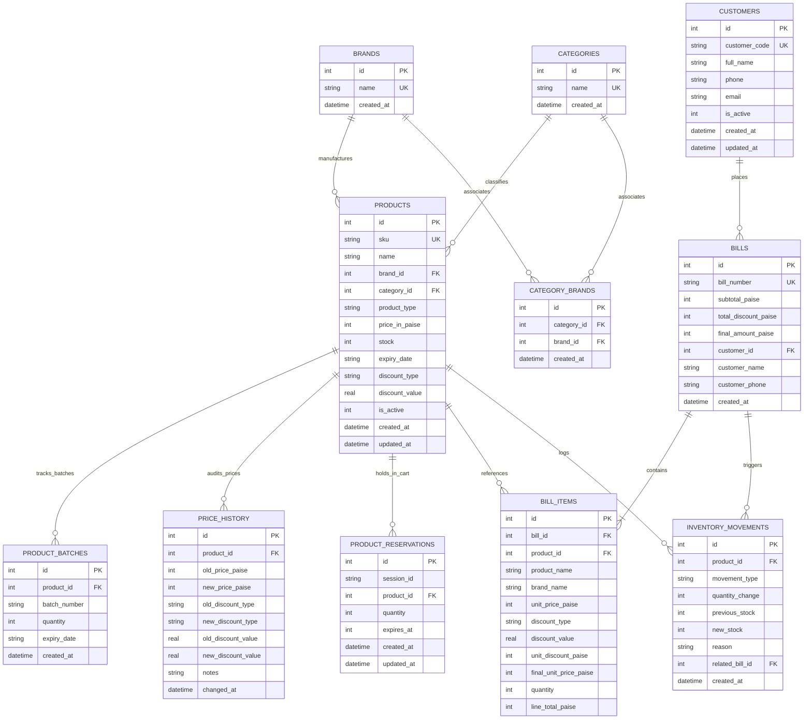

# Database Schema Specification & Storage Guide

## Table of Contents
- [1. Canonical Database Path](#1-canonical-database-path)
- [2. Storage Engine & PRAGMA Settings](#2-storage-engine-pragma-settings)
- [3. Schema Migrations (`DatabaseMigrator`)](#3-schema-migrations-databasemigrator)
- [4. Entity-Relationship Model](#4-entity-relationship-model)
- [5. Detailed Table Definitions](#5-detailed-table-definitions)
  - [5.1 `brands`](#51-brands)
  - [5.2 `categories`](#52-categories)
  - [5.3 `category_brands`](#53-category_brands)
  - [5.4 `products`](#54-products)
  - [5.5 `product_batches` (FEFO Batches)](#55-product_batches-fefo-batches)
  - [5.6 `price_history` (Audit Log)](#56-price_history-audit-log)
  - [5.7 `product_reservations` (Cart Holds)](#57-product_reservations-cart-holds)
  - [5.8 `customers`](#58-customers)
  - [5.9 `bills`](#59-bills)
  - [5.10 `bill_items`](#510-bill_items)
  - [5.11 `inventory_movements`](#511-inventory_movements)
  - [5.12 `users`](#512-users)
  - [5.13 `system_metadata`](#513-system_metadata)
- [6. Financial Data Representation (Paise Currency Invariant)](#6-financial-data-representation-paise-currency-invariant)
- [7. Multi-Session Cart Reservation Mechanics](#7-multi-session-cart-reservation-mechanics)
- [8. Immutable Historical Snapshots](#8-immutable-historical-snapshots)
- [9. Backup and Restore Procedures](#9-backup-and-restore-procedures)

---

## 1. Canonical Database Path

All components of the Supermarket Billing & Inventory Management System (the C++ server, PowerShell launcher, C++ seeder, and automated test runners) target a single canonical local SQLite database file:

$$\mathbf{backend/data/supermarket.db}$$

- **Windows Workspace Path:**  
  `backend\data\supermarket.db`
- **Sidecar Files (WAL Mode):**
  - `backend/data/supermarket.db-wal` (Write-Ahead Log)
  - `backend/data/supermarket.db-shm` (Shared-Memory Index)

*Note: All `*.db`, `*.db-wal`, and `*.db-shm` files are excluded from Git tracking via `.gitignore`.*

---

## 2. Storage Engine & PRAGMA Settings

The database is powered by the embedded **SQLite 3.46.1 amalgamation**. On initialization, `DatabaseConnection` enforces:
```sql
PRAGMA journal_mode = WAL;
PRAGMA foreign_keys = ON;
PRAGMA synchronous = NORMAL;
```
- **WAL Mode:** Permits non-blocking concurrent readers during write transactions.
- **Foreign Keys:** Strict referential integrity enforcement on all child relationships.
- **Synchronous Normal:** Ensures ACID durability while minimizing unnecessary fsync operations on solid-state drives.

---

## 3. Schema Migrations (`DatabaseMigrator`)

Schema evolution is automated via `DatabaseMigrator::migrate(DatabaseConnection& conn)`. It uses SQLite's internal version register via `PRAGMA user_version`:

### Migration History
- **Version 1:** Initial core domain schema (`brands`, `categories`, `products`, `bills`, `bill_items`, `inventory_movements`).
- **Version 2:** Administrative authentication and user management (`users` table with PBKDF2-HMAC-SHA256).
- **Version 3:** Customer management and CRM snapshotting (`customers` table, customer columns in `bills`, `system_metadata`).
- **Version 4:** Category-brand taxonomy junction (`category_brands` table with pre-seeded brand-category links).
- **Version 5:** Multi-batch inventory tracking (`product_batches` table with FEFO indexes) and price modification auditing (`price_history` table).
- **Version 6:** Multi-session cart stock reservations (`product_reservations` table with TTL index).

Migrations execute within an explicit `Transaction` object; if any DDL statement fails, SQLite rolls back the entire transaction and `PRAGMA user_version` remains unchanged.

---

## 4. Entity-Relationship Model



---

## 5. Detailed Table Definitions

### 5.1 `brands`
Stores registered manufacturer and distributor brands.
```sql
CREATE TABLE IF NOT EXISTS brands (
    id INTEGER PRIMARY KEY AUTOINCREMENT,
    name TEXT NOT NULL UNIQUE,
    created_at DATETIME DEFAULT CURRENT_TIMESTAMP
);
```

### 5.2 `categories`
Stores product categories and store departments.
```sql
CREATE TABLE IF NOT EXISTS categories (
    id INTEGER PRIMARY KEY AUTOINCREMENT,
    name TEXT NOT NULL UNIQUE,
    created_at DATETIME DEFAULT CURRENT_TIMESTAMP
);
```

### 5.3 `category_brands`
Junction table relating brands to categories for filtered catalog navigation.
```sql
CREATE TABLE IF NOT EXISTS category_brands (
    id INTEGER PRIMARY KEY AUTOINCREMENT,
    category_id INTEGER NOT NULL,
    brand_id INTEGER NOT NULL,
    created_at DATETIME DEFAULT CURRENT_TIMESTAMP,
    FOREIGN KEY (category_id) REFERENCES categories(id) ON DELETE CASCADE,
    FOREIGN KEY (brand_id) REFERENCES brands(id) ON DELETE CASCADE,
    UNIQUE(category_id, brand_id)
);
```

### 5.4 `products`
Master store catalog containing current total stock counts and pricing.
```sql
CREATE TABLE IF NOT EXISTS products (
    id INTEGER PRIMARY KEY AUTOINCREMENT,
    sku TEXT NOT NULL UNIQUE,
    name TEXT NOT NULL,
    brand_id INTEGER NOT NULL,
    category_id INTEGER NOT NULL,
    product_type TEXT NOT NULL CHECK (product_type IN ('PERISHABLE', 'NON_PERISHABLE')),
    price_in_paise INTEGER NOT NULL CHECK (price_in_paise >= 0),
    stock INTEGER NOT NULL DEFAULT 0 CHECK (stock >= 0),
    expiry_date TEXT,
    discount_type TEXT NOT NULL DEFAULT 'NONE' CHECK (discount_type IN ('NONE', 'PERCENTAGE', 'FIXED')),
    discount_value REAL NOT NULL DEFAULT 0.0 CHECK (discount_value >= 0),
    is_active INTEGER NOT NULL DEFAULT 1 CHECK (is_active IN (0, 1)),
    created_at DATETIME DEFAULT CURRENT_TIMESTAMP,
    updated_at DATETIME DEFAULT CURRENT_TIMESTAMP,
    FOREIGN KEY (brand_id) REFERENCES brands(id) ON DELETE RESTRICT,
    FOREIGN KEY (category_id) REFERENCES categories(id) ON DELETE RESTRICT
);
```

### 5.5 `product_batches` (FEFO Batches)
Tracks distinct delivery batches for perishable products. Enables First-Expired, First-Out (FEFO) stock deduction during POS sales.
```sql
CREATE TABLE IF NOT EXISTS product_batches (
    id INTEGER PRIMARY KEY AUTOINCREMENT,
    product_id INTEGER NOT NULL,
    batch_number TEXT NOT NULL,
    quantity INTEGER NOT NULL CHECK (quantity >= 0),
    expiry_date TEXT NOT NULL,
    created_at DATETIME DEFAULT CURRENT_TIMESTAMP,
    FOREIGN KEY (product_id) REFERENCES products(id) ON DELETE CASCADE
);
CREATE INDEX IF NOT EXISTS idx_batches_product ON product_batches(product_id);
CREATE INDEX IF NOT EXISTS idx_batches_expiry ON product_batches(expiry_date);
```

### 5.6 `price_history` (Audit Log)
Maintains an immutable historical audit log of every price and discount modification performed by staff.
```sql
CREATE TABLE IF NOT EXISTS price_history (
    id INTEGER PRIMARY KEY AUTOINCREMENT,
    product_id INTEGER NOT NULL,
    old_price_paise INTEGER NOT NULL,
    new_price_paise INTEGER NOT NULL,
    old_discount_type TEXT NOT NULL,
    new_discount_type TEXT NOT NULL,
    old_discount_value REAL NOT NULL,
    new_discount_value REAL NOT NULL,
    notes TEXT,
    changed_at DATETIME DEFAULT CURRENT_TIMESTAMP,
    FOREIGN KEY (product_id) REFERENCES products(id) ON DELETE CASCADE
);
CREATE INDEX IF NOT EXISTS idx_price_history_product ON price_history(product_id);
CREATE INDEX IF NOT EXISTS idx_price_history_time ON price_history(changed_at);
```

### 5.7 `product_reservations` (Cart Holds)
Enforces multi-session stock reservations with a 15-minute Time-To-Live (TTL).
```sql
CREATE TABLE IF NOT EXISTS product_reservations (
    id INTEGER PRIMARY KEY AUTOINCREMENT,
    session_id TEXT NOT NULL,
    product_id INTEGER NOT NULL,
    quantity INTEGER NOT NULL CHECK (quantity > 0),
    expires_at INTEGER NOT NULL,
    created_at DATETIME DEFAULT CURRENT_TIMESTAMP,
    updated_at DATETIME DEFAULT CURRENT_TIMESTAMP,
    FOREIGN KEY (product_id) REFERENCES products(id) ON DELETE CASCADE,
    UNIQUE(session_id, product_id)
);
CREATE INDEX IF NOT EXISTS idx_reservations_session ON product_reservations(session_id);
CREATE INDEX IF NOT EXISTS idx_reservations_product ON product_reservations(product_id);
CREATE INDEX IF NOT EXISTS idx_reservations_expires ON product_reservations(expires_at);
```

### 5.8 `customers`
Customer directory for CRM, contact info, and loyalty checkout linking.
```sql
CREATE TABLE IF NOT EXISTS customers (
    id INTEGER PRIMARY KEY AUTOINCREMENT,
    customer_code TEXT NOT NULL UNIQUE,
    full_name TEXT NOT NULL,
    phone TEXT,
    email TEXT,
    is_active INTEGER NOT NULL DEFAULT 1 CHECK (is_active IN (0, 1)),
    created_at DATETIME DEFAULT CURRENT_TIMESTAMP,
    updated_at DATETIME DEFAULT CURRENT_TIMESTAMP
);
```

### 5.9 `bills` (Sales Invoices)
Invoice headers representing finalized sales transactions.
```sql
CREATE TABLE IF NOT EXISTS bills (
    id INTEGER PRIMARY KEY AUTOINCREMENT,
    bill_number TEXT NOT NULL UNIQUE,
    subtotal_paise INTEGER NOT NULL CHECK (subtotal_paise >= 0),
    total_discount_paise INTEGER NOT NULL CHECK (total_discount_paise >= 0),
    final_amount_paise INTEGER NOT NULL CHECK (final_amount_paise >= 0),
    customer_id INTEGER,
    customer_name TEXT,
    customer_phone TEXT,
    created_at DATETIME DEFAULT CURRENT_TIMESTAMP,
    FOREIGN KEY (customer_id) REFERENCES customers(id) ON DELETE SET NULL
);
```

### 5.10 `bill_items` (Historical Line-Item Snapshots)
Immutable line items captured at checkout time.
```sql
CREATE TABLE IF NOT EXISTS bill_items (
    id INTEGER PRIMARY KEY AUTOINCREMENT,
    bill_id INTEGER NOT NULL,
    product_id INTEGER,
    product_name TEXT NOT NULL,
    brand_name TEXT NOT NULL,
    unit_price_paise INTEGER NOT NULL,
    discount_type TEXT NOT NULL,
    discount_value REAL NOT NULL,
    unit_discount_paise INTEGER NOT NULL,
    final_unit_price_paise INTEGER NOT NULL,
    quantity INTEGER NOT NULL CHECK (quantity > 0),
    line_total_paise INTEGER NOT NULL CHECK (line_total_paise >= 0),
    FOREIGN KEY (bill_id) REFERENCES bills(id) ON DELETE CASCADE,
    FOREIGN KEY (product_id) REFERENCES products(id) ON DELETE SET NULL
);
```

### 5.11 `inventory_movements` (Immutable Audit Ledger)
Append-only log recording every stock change in the supermarket.
```sql
CREATE TABLE IF NOT EXISTS inventory_movements (
    id INTEGER PRIMARY KEY AUTOINCREMENT,
    product_id INTEGER NOT NULL,
    movement_type TEXT NOT NULL CHECK (movement_type IN ('ADDITION', 'REDUCTION', 'SALE', 'ADJUSTMENT')),
    quantity_change INTEGER NOT NULL,
    previous_stock INTEGER NOT NULL,
    new_stock INTEGER NOT NULL,
    reason TEXT,
    related_bill_id INTEGER,
    created_at DATETIME DEFAULT CURRENT_TIMESTAMP,
    FOREIGN KEY (product_id) REFERENCES products(id) ON DELETE RESTRICT,
    FOREIGN KEY (related_bill_id) REFERENCES bills(id) ON DELETE SET NULL
);
```

### 5.12 `users` (Staff Credentials)
Stores password hashes and cryptographically secure salts.
```sql
CREATE TABLE IF NOT EXISTS users (
    id INTEGER PRIMARY KEY AUTOINCREMENT,
    username TEXT NOT NULL UNIQUE,
    password_hash TEXT NOT NULL,
    salt TEXT NOT NULL,
    iterations INTEGER NOT NULL DEFAULT 100000,
    role TEXT NOT NULL CHECK (role IN ('ADMIN', 'STAFF')),
    created_at DATETIME DEFAULT CURRENT_TIMESTAMP,
    updated_at DATETIME DEFAULT CURRENT_TIMESTAMP
);
```

### 5.13 `system_metadata`
Key-value storage for initialization flags and system configuration.
```sql
CREATE TABLE IF NOT EXISTS system_metadata (
    key TEXT PRIMARY KEY,
    value TEXT NOT NULL,
    created_at DATETIME DEFAULT CURRENT_TIMESTAMP
);
```

---

## 6. Financial Data Representation (Paise Currency Invariant)

To guarantee that calculations never suffer from IEEE 754 binary floating-point rounding drift, all monetary fields strictly utilize signed 64-bit integer paise (`int64_t`):

$$1\text{ Rupee} = 100\text{ Paise}$$

- **Product Price:** A ₹295.00 shelf price is stored as `29500`.
- **Percentage Discount Calculation:**
  $$\text{discountPaise} = \text{round}\left(\frac{\text{priceInPaise} \times \text{percent}}{100.0}\right)$$
- **Non-Negative Clamping:**
  $$\text{finalUnitPricePaise} = \max\bigl(0,\, \text{priceInPaise} - \text{discountPaise}\bigr)$$
- **Line Item Total:**
  $$\text{lineTotalPaise} = \text{finalUnitPricePaise} \times \text{quantity}$$

---

## 7. Multi-Session Cart Reservation Mechanics

To guarantee fair inventory distribution among concurrent online shoppers and in-store cashiers:
1. **Hold Reservation:** `POST /api/cart/reserve` creates an entry in `product_reservations` with a 15-minute TTL.
2. **Dynamic Stock Calculation:**
   $$\text{availableStock} = \max\bigl(0,\, \text{totalStock} - \text{reservedStock}\bigr)$$
3. **Atomic Checkout Clearance:** During invoice generation (`POST /api/bills`), all reservations tied to `sessionId` are atomically deleted within the same database transaction.

---

## 8. Immutable Historical Snapshots

Supermarket invoices must remain legally and financially immutable:
- If a product's price increases from ₹50 to ₹60 next month, past invoices must continue to reflect ₹50.
- If a promotional 10% discount is retired, past sales receipts must retain their 10% savings line.
- If a product is soft-deleted, historical bills must still display the original product name and brand name.

This is achieved by decoupling the `bill_items` table from the live `products` row: `bill_items` snapshots `product_name`, `brand_name`, `unit_price_paise`, `discount_type`, `discount_value`, and `final_unit_price_paise` at the exact instant of checkout.

---

## 9. Backup and Restore Procedures

Because SQLite operates in WAL mode, database backups must be taken without interfering with active writers:

```powershell
# Clean backup using SQLite's online vacuum/backup command
sqlite3 backend\data\supermarket.db ".backup 'backend\data\supermarket_backup.db'"
```
Restoring simply requires stopping the backend process and copying the backup file over `supermarket.db`.
