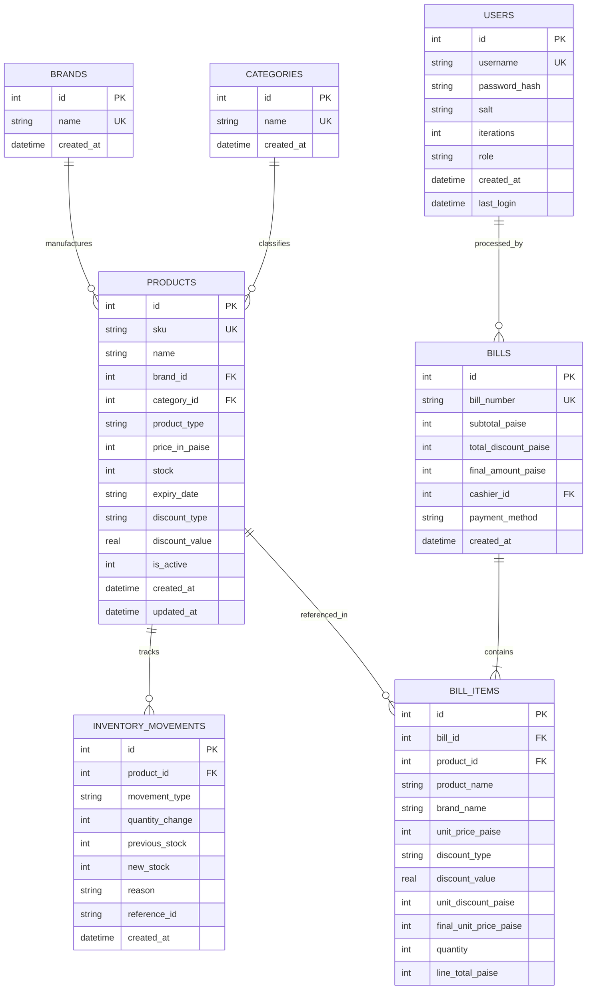

# Database Schema Specification & Storage Guide

## Table of Contents
- [1. Canonical Database Path](#1-canonical-database-path)
- [2. Storage Engine & PRAGMA Settings](#2-storage-engine-pragma-settings)
- [3. Schema Migrations (`DatabaseMigrator`)](#3-schema-migrations-databasemigrator)
- [4. Entity-Relationship Model](#4-entity-relationship-model)
- [5. Detailed Table Definitions](#5-detailed-table-definitions)
  - [5.1 `brands`](#51-brands)
  - [5.2 `categories`](#52-categories)
  - [5.3 `products`](#53-products)
  - [5.4 `bills`](#54-bills)
  - [5.5 `bill_items`](#55-bill_items)
  - [5.6 `inventory_movements`](#56-inventory_movements)
  - [5.7 `users`](#57-users)
- [6. Financial Data Representation (Paise Currency Invariant)](#6-financial-data-representation-paise-currency-invariant)
- [7. Immutable Historical Snapshots](#7-immutable-historical-snapshots)
- [8. Backup and Restore Procedures](#8-backup-and-restore-procedures)

---

## 1. Canonical Database Path

All components of the Supermarket Billing & Inventory Management System (the C++ server, PowerShell launcher, C++ seeder, and Python seeder) target a single canonical local SQLite database file:

$$\mathbf{backend/data/supermarket.db}$$

- **Full Windows Workspace Path:**  
  `C:\Users\LENOVO\Desktop\OOPS-Sem-III-Lab\Supermarket_Submission_Staging\Supermarket_Management_System\backend\data\supermarket.db`
- **Sidecar Files (WAL Mode):**
  - `backend/data/supermarket.db-wal` (Write-Ahead Log)
  - `backend/data/supermarket.db-shm` (Shared-Memory Index)

*Note: All `*.db`, `*.db-wal`, and `*.db-shm` files are excluded from Git tracking via `.gitignore`.*

---

## 2. Storage Engine & PRAGMA Settings

The database is powered by the embedded **SQLite 3.46.1 amalgamation**. On initialization, `DatabaseConnection` enforces:
```sql
PRAGMA journal_mode = WAL;
PRAGMA foreign_keys = ON;
PRAGMA synchronous = NORMAL;
```
- **WAL Mode:** Permits non-blocking concurrent readers during write transactions.
- **Foreign Keys:** Strict referential integrity enforcement on all child relationships.

---

## 3. Schema Migrations (`DatabaseMigrator`)

Schema evolution is automated via `DatabaseMigrator::migrate(DatabaseConnection& db)`.

### Version History
- **Version 1:** Initial core domain schema (`brands`, `categories`, `products`, `bills`, `bill_items`, `inventory_movements`).
- **Version 2:** Administrative authentication and user management (`users` table).

A meta-table tracks the applied migration version:
```sql
CREATE TABLE IF NOT EXISTS schema_migrations (
    version INTEGER PRIMARY KEY,
    applied_at DATETIME DEFAULT CURRENT_TIMESTAMP
);
```

---

## 4. Entity-Relationship Model



---

## 5. Detailed Table Definitions

### 5.1 `brands`
Stores manufacturer brands.
```sql
CREATE TABLE brands (
    id INTEGER PRIMARY KEY AUTOINCREMENT,
    name TEXT NOT NULL UNIQUE,
    created_at DATETIME DEFAULT CURRENT_TIMESTAMP
);
```

### 5.2 `categories`
Stores store department categories.
```sql
CREATE TABLE categories (
    id INTEGER PRIMARY KEY AUTOINCREMENT,
    name TEXT NOT NULL UNIQUE,
    created_at DATETIME DEFAULT CURRENT_TIMESTAMP
);
```

### 5.3 `products`
The core catalog inventory table.
```sql
CREATE TABLE products (
    id INTEGER PRIMARY KEY AUTOINCREMENT,
    sku TEXT NOT NULL UNIQUE,
    name TEXT NOT NULL,
    brand_id INTEGER NOT NULL REFERENCES brands(id),
    category_id INTEGER NOT NULL REFERENCES categories(id),
    product_type TEXT NOT NULL CHECK (product_type IN ('PERISHABLE', 'NON_PERISHABLE')),
    price_in_paise INTEGER NOT NULL CHECK (price_in_paise >= 0),
    stock INTEGER NOT NULL DEFAULT 0 CHECK (stock >= 0),
    expiry_date TEXT DEFAULT NULL,
    discount_type TEXT NOT NULL DEFAULT 'NONE' CHECK (discount_type IN ('NONE', 'PERCENTAGE', 'FIXED')),
    discount_value REAL NOT NULL DEFAULT 0.0,
    is_active INTEGER NOT NULL DEFAULT 1,
    created_at DATETIME DEFAULT CURRENT_TIMESTAMP,
    updated_at DATETIME DEFAULT CURRENT_TIMESTAMP
);
```

### 5.4 `bills`
Represents finalized customer checkout transactions.
```sql
CREATE TABLE bills (
    id INTEGER PRIMARY KEY AUTOINCREMENT,
    bill_number TEXT NOT NULL UNIQUE,
    subtotal_paise INTEGER NOT NULL,
    total_discount_paise INTEGER NOT NULL,
    final_amount_paise INTEGER NOT NULL,
    cashier_id INTEGER,
    payment_method TEXT DEFAULT 'CASH',
    created_at DATETIME DEFAULT CURRENT_TIMESTAMP
);
```

### 5.5 `bill_items`
Immutable historical snapshot of each line item in a finalized bill.
```sql
CREATE TABLE bill_items (
    id INTEGER PRIMARY KEY AUTOINCREMENT,
    bill_id INTEGER NOT NULL REFERENCES bills(id) ON DELETE CASCADE,
    product_id INTEGER REFERENCES products(id),
    product_name TEXT NOT NULL,
    brand_name TEXT NOT NULL,
    unit_price_paise INTEGER NOT NULL,
    discount_type TEXT NOT NULL DEFAULT 'NONE',
    discount_value REAL NOT NULL DEFAULT 0.0,
    unit_discount_paise INTEGER NOT NULL DEFAULT 0,
    final_unit_price_paise INTEGER NOT NULL,
    quantity INTEGER NOT NULL CHECK (quantity > 0),
    line_total_paise INTEGER NOT NULL
);
```

### 5.6 `inventory_movements`
The append-only audit trail logging every stock modification.
```sql
CREATE TABLE inventory_movements (
    id INTEGER PRIMARY KEY AUTOINCREMENT,
    product_id INTEGER NOT NULL REFERENCES products(id),
    movement_type TEXT NOT NULL CHECK (movement_type IN ('ADDITION', 'REDUCTION', 'SALE', 'ADJUSTMENT')),
    quantity_change INTEGER NOT NULL,
    previous_stock INTEGER NOT NULL,
    new_stock INTEGER NOT NULL,
    reason TEXT NOT NULL,
    reference_id TEXT,
    created_at DATETIME DEFAULT CURRENT_TIMESTAMP
);
```

### 5.7 `users`
Stores salted PBKDF2 credential hashes for administrative authentication.
```sql
CREATE TABLE users (
    id INTEGER PRIMARY KEY AUTOINCREMENT,
    username TEXT NOT NULL UNIQUE,
    password_hash TEXT NOT NULL,
    salt TEXT NOT NULL,
    iterations INTEGER NOT NULL DEFAULT 100000,
    role TEXT NOT NULL CHECK (role IN ('ADMIN', 'STAFF')),
    created_at DATETIME DEFAULT CURRENT_TIMESTAMP,
    last_login DATETIME
);
```

---

## 6. Financial Data Representation (Paise Currency Invariant)

To guarantee exact accounting without binary floating-point drift:
- All monetary columns (`price_in_paise`, `subtotal_paise`, `total_discount_paise`, `final_amount_paise`, `line_total_paise`) are stored as **integers representing paise**.
- In the C++ domain, they map to `int64_t`.
- Conversion to Indian Rupees (`₹`) is performed strictly at the presentation boundary:
  $$\text{Rupees} = \frac{\text{priceInPaise}}{100.0}$$

---

## 7. Immutable Historical Snapshots

When a bill is finalized in `BillRepository::createBill`:
1. The line item's current name, brand, unit price, applied discount strategy, and computed line total are cloned into `bill_items`.
2. Even if a product's master price is subsequently edited or the product is soft-deactivated, past receipts rendered from `bill_items` remain permanently immutable.

---

## 8. Backup and Restore Procedures

### Safe Live Backup (WAL Truncation First)
Because SQLite in WAL mode splits active data across `supermarket.db` and `supermarket.db-wal`, a safe backup should checkpoint the WAL before copying:

```powershell
# Using Python
python -c "
import sqlite3, shutil, datetime
db_path = r'backend\data\supermarket.db'
conn = sqlite3.connect(db_path)
conn.execute('PRAGMA wal_checkpoint(TRUNCATE);')
conn.close()
ts = datetime.datetime.now().strftime('%Y%m%d_%H%M%S')
shutil.copy2(db_path, f'database_backups/backup_{ts}.db')
print('Backup created successfully!')
"
```

### Restoration
1. Stop the application server (`supermarket_server.exe`).
2. Replace `backend/data/supermarket.db` with the backup copy.
3. Remove any residual `backend/data/supermarket.db-wal` and `backend/data/supermarket.db-shm` files.
4. Restart the application via `.\start-app.ps1`.
