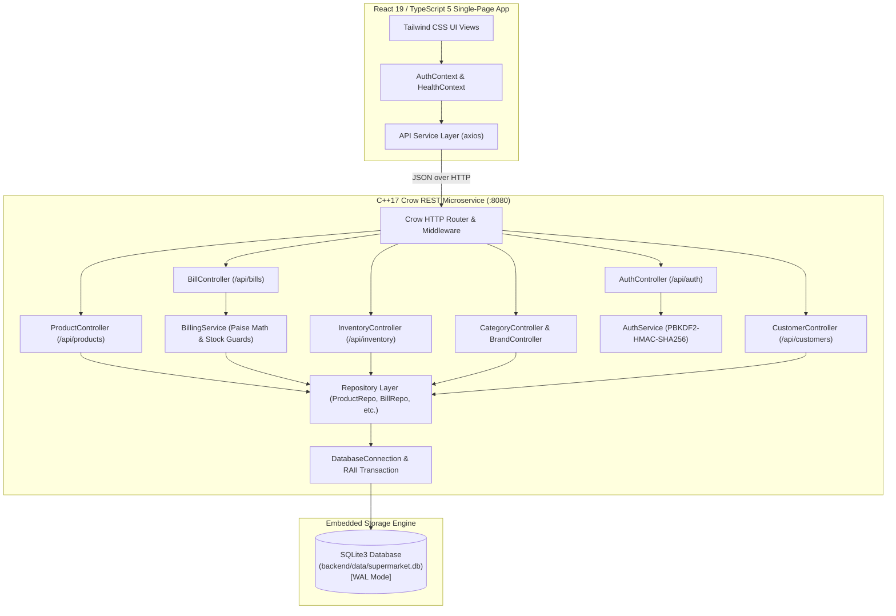

# Academic Project Report: Supermarket Billing & Inventory Management System

**Course:** Object-Oriented Programming in C++ (CS201 / Sem III Lab)
**System Name:** Supermarket Billing & Inventory Management System (ApexMart)
**Architecture:** Decoupled C++17 Crow REST Backend + SQLite3 Persistence + React 19 / TypeScript 5 Frontend
**Operating Modes:** Exactly Two Modes — Customer Mode (Public) & Staff Mode (Authenticated)
**Academic Reference:** Preserved unmodified legacy baseline at `Supermarket_billing_System/1.cpp`

---

## Table of Contents
1. [Abstract](#1-abstract)
2. [Introduction](#2-introduction)
3. [Problem Statement](#3-problem-statement)
4. [Objectives](#4-objectives)
5. [Scope of the Project](#5-scope-of-the-project)
6. [Existing System vs. Proposed System](#6-existing-system-vs-proposed-system)
7. [Functional Requirements](#7-functional-requirements)
8. [Non-Functional Requirements](#8-non-functional-requirements)
9. [Hardware & Software Requirements](#9-hardware--software-requirements)
10. [System Architecture](#10-system-architecture)
11. [Implementation Details](#11-implementation-details)
12. [Testing Methodology & Results](#12-testing-methodology--results)
13. [System Limitations](#13-system-limitations)
14. [Future Enhancements](#14-future-enhancements)
15. [Conclusion](#15-conclusion)

---

## 1. Abstract

The **Supermarket Billing & Inventory Management System (ApexMart)** is an enterprise-grade retail software application engineered to satisfy the rigorous academic and practical requirements of an advanced Object-Oriented Programming (OOP) curriculum in C++. Traditional academic billing software often relies on monolithic console loops, raw pointers, volatile file storage, and floating-point arithmetic prone to catastrophic rounding drift.

This project re-engineers that baseline into a high-concurrency, multi-tiered client-server architecture:
1. A **C++17 backend microservice** powered by the Crow HTTP framework and standalone Asio.
2. An embedded **SQLite3** transactional persistence engine utilizing Write-Ahead Logging (WAL) and strict ACID semantics.
3. A reactive **React 19 / TypeScript 5 Single-Page Application (SPA)** built with Vite and styled with Tailwind CSS.

The system enforces a clean **Two-Mode Role Architecture**:
- **Customer Mode:** An open, unauthenticated public portal enabling customers to discover products, check real-time shelf prices, add items to a self-service shopping cart, execute atomic checkouts, and print itemized thermal receipts.
- **Staff Mode:** A password-authenticated operational management environment protected by PBKDF2-HMAC-SHA256 password hashing and tokenized sessions. Authenticated staff gain full access to operational KPI analytics, product inventory management, stock intake and write-off auditing, brand and category relationship taxonomy, and transaction ledgers.

Financial integrity is strictly enforced across all database tables and algorithms using a **64-bit signed integer representation of currency in paise** ($\text{INR } 1.00 = 100\text{ paise}$), eliminating binary floating-point rounding errors. All core OOP tenets—encapsulation, abstraction, polymorphic inheritance, diamond inheritance disambiguation, templates, RAII, operator overloading, and design patterns (Strategy, Repository)—are deeply integrated into real domain operations.

---

## 2. Introduction

Modern supermarket operations require reliable data synchronization between Point-of-Sale (POS) terminals, back-office inventory monitoring, and customer-facing catalogs. In retail management, overselling out-of-stock items, misapplying promotional discounts, or accumulating fractional cent rounding errors during daily aggregate reconciliations can lead to substantial financial discrepancy and customer dissatisfaction.

This project bridge the gap between abstract academic OOP principles and real-world industrial software engineering. Rather than implementing textbook OOP concepts as toy exercises, each mechanism maps directly to retail business logic:
- **Polymorphism** models dynamic promotional discounting algorithms (`PercentageDiscount`, `FixedDiscount`, `NoDiscount`) and product lifecycles (`Perishable` vs. `NonPerishable`).
- **RAII (Resource Acquisition Is Initialization)** governs database transaction lifecycles (`Transaction`), prepared statement parameter bindings (`PreparedStatement`), and memory isolation (`std::unique_ptr`).
- **Operator Overloading** simplifies shopping cart aggregation (`operator+=`) and formatted receipt generation (`operator<<`).
- **Diamond Inheritance** resolves ambiguity in store personnel modeling (`Manager` inheriting from both `Cashier` and `InventoryStaff` via virtual base `Employee`).

---

## 3. Problem Statement

Legacy academic supermarket billing programs suffer from fundamental architectural deficiencies:
1. **Volatile or Primitive Storage:** Data is stored in raw binary/text files (`.txt`, `.dat`) without transaction isolation, causing data corruption during abrupt shutdowns or concurrent writes.
2. **Floating-Point Drift:** Using `float` or `double` for currency causes precision loss ($0.10 + 0.20 \neq 0.30$), leading to balancing errors in invoices.
3. **Monolithic Console Traps:** Command-line interfaces block execution threads, offer zero remote access, and mix business logic, database queries, and UI rendering into single monolithic files.
4. **Lack of Concurrency Control:** Simultaneous customer checkouts can decrement inventory below zero, resulting in phantom inventory and unfulfillable orders.
5. **No Role Separation:** The same console screen permits unrestricted product deletion, price modification, and bill generation without authentication barriers.

ApexMart resolves every one of these problems with a decoupled REST architecture, relational database transactions, integer paise currency, and an authenticated two-mode security boundary.

---

## 4. Objectives

The primary objectives of this engineering project are:
- **Design & Implement a Decoupled Client-Server Retail System:** Build a high-performance C++17 RESTful backend communicating over JSON with a modern React frontend.
- **Enforce Exact Two-Mode Operation:**
  - *Customer Mode:* Frictionless catalog browsing and POS checkout without requiring login.
  - *Staff Mode:* Password-protected operational management portal with zero administrative bloat.
- **Guarantee ACID Transactional Integrity:** Use SQLite transactions to execute multi-item checkouts and stock deductions as single atomic operations (`Transaction` RAII class).
- **Implement Non-Floating-Point Currency:** Guarantee zero rounding error across all database tables, models, and JSON responses using signed 64-bit integer paise.
- **Demonstrate Advanced C++17 OOP Concepts:** Provide an educational `/oop-concepts` portal showcasing live dynamic dispatch, strategy patterns, virtual inheritance, and template programming.
- **Achieve Comprehensive Automated Test Verification:** Build and verify 5 CTest suites covering discount calculations, inventory guards, billing operators, database persistence, and REST API route security.

---

## 5. Scope of the Project

### In-Scope Functionality
- **Public Customer Portal:** Department showcase, brand discovery, real-time stock availability, shopping cart management, atomic checkout, and printable 80mm thermal receipts.
- **Staff Operations Dashboard:** 5 operational KPI summary cards (Today's Sales, Today's Bills, Total Active Products, Low Stock Alerts, Out of Stock Count), 7-day revenue trend charts, and recent transaction feeds.
- **Inventory & Catalog Management:** Product catalog with search, category/brand filters, perishable expiry tracking, manual stock intake/write-off auditing, and category-brand taxonomy mapping.
- **Point-of-Sale (POS) Billing:** Barcode/SKU reactive search, live quantity controls with stock guards, customer detail linking, and instant invoice printing.
- **Security & Session Management:** PBKDF2-HMAC-SHA256 password hashing with 100,000 iterations and 128-bit random salt, bearer token session validation, and automatic customer session fallback upon logout.

### Out-of-Scope (Design Boundaries)
- Payment Gateway Integrations (simulated as instant cash/card completion).
- Multi-store distributed inventory synchronization across different geographic locations.
- Hardware-level physical barcode laser scanner driver integration (handled via standard USB keyboard emulation).

---

## 6. Existing System vs. Proposed System

| Feature / Dimension | Legacy Academic Console Baseline (`1.cpp`) | Proposed System (ApexMart) |
| :--- | :--- | :--- |
| **User Interface** | Monolithic text console (`std::cin` / `std::cout`) | Responsive web UI (React 19 + TypeScript + Tailwind CSS) |
| **Architecture** | Single-tier monolithic executable | Multi-tier client-server (C++17 Crow REST API + SPA) |
| **Persistence** | Volatile memory or unindexed text files | SQLite 3.46.1 with WAL mode and foreign key constraints |
| **Concurrency** | Single-threaded blocking input loop | Asynchronous multi-threaded HTTP server (Standalone Asio) |
| **Currency Handling** | Floating-point `float` / `double` | 64-bit signed integer paise (`int64_t`) — zero drift |
| **Transaction Safety** | Non-existent; partial writes corrupt files | Strict ACID transactions with automatic RAII rollback |
| **Stock Guards** | Primitive conditional checks | Atomic decrement with SQLite `CHECK (stock >= 0)` |
| **Role Architecture** | Open menu with no access controls | Exactly Two Modes: Public Customer vs. Authenticated Staff |
| **Authentication** | Hardcoded plaintext comparison | PBKDF2-HMAC-SHA256 (100,000 iterations, 128-bit salt) |
| **Audit Logging** | None | Append-only `inventory_movements` ledger for all stock shifts |

---

## 7. Functional Requirements

### 7.1 Customer Mode (Public)
1. **Catalog Browsing:** Browse all active supermarket products categorized by department (Grains, Dairy, Snacks, Beverages, Personal Care, Household, Produce).
2. **Product Detail & Search:** Filter by category, brand, or text search; view real-time unit prices and perishable expiry dates.
3. **Cart Assembly:** Add items to cart; adjust quantities with client-side stock availability limits.
4. **Self-Service Checkout:** Enter customer name/phone (optional), submit checkout payload to `POST /api/bills`, and receive an immutable electronic invoice.
5. **Receipt Modal:** View itemized receipt with line-item discounts, subtotal, savings, and final total; print via `@media print` thermal layout.

### 7.2 Staff Mode (Authenticated)
1. **Authentication:** Authenticate via password modal (`POST /api/auth/staff/login`). Session token stored in browser session.
2. **Dashboard Overview:** Monitor real-time daily metrics: Today's Sales, Today's Bills, Total Products, Low Stock count, Out of Stock count, and weekly revenue graphs.
3. **Product Management:** Add new products with SKU, name, brand, category, perishable status, expiry date, price in paise, and discount strategy. Update existing items or toggle active status.
4. **Inventory Management:** View current stock levels; filter items with $\text{stock} \le 5$ (Low Stock); record stock additions or write-offs with audit reasons.
5. **Category & Brand Management:** Create new categories and brands; map authorized brands to categories via the `category_brands` junction table.
6. **Transaction Audit Ledger:** Browse all historical store bills; view snapshot details including historical product names, brands, and prices at time of purchase.
7. **Session Invalidation:** Log out at any time (`POST /api/auth/logout`), immediately reverting the interface to Customer Mode and revoking management privileges.

---

## 8. Non-Functional Requirements

1. **Financial Precision:** Currency is represented in integer paise. No division is executed until final display formatting ($\text{rupees} = \text{paise} / 100.0$).
2. **Data Consistency & Isolation:** All inventory deductions occur within a single database transaction. If any product in a multi-item bill fails stock validation, the entire checkout rolls back.
3. **Security:** Passwords are never stored in plaintext. Passwords utilize PBKDF2-HMAC-SHA256 with a cryptographically secure pseudo-random salt (BCrypt on Windows, OpenSSL 3.x on Linux). Management routes reject unauthenticated requests with HTTP 401.
4. **Performance:** Crow and standalone Asio handle HTTP request dispatching in under $10\text{ ms}$ on local loopback. SQLite indexes on `sku`, `bill_number`, `created_at`, and foreign keys optimize lookup queries.
5. **Portability:** Backend compiles under MSVC (Visual Studio 2022) on Windows and GCC/Clang on Linux. A multi-stage `Dockerfile` is provided for containerized Linux deployments.

---

## 9. Hardware & Software Requirements

### Development & Host Machine
- **Operating System:** Windows 10 / 11 (64-bit) or Ubuntu Linux 22.04+ LTS.
- **Processor:** Intel Core i3 / AMD Ryzen 3 or higher.
- **RAM:** Minimum 4 GB (8 GB recommended for compilation).
- **Storage:** 2 GB free disk space (includes build artifacts and MSVC/Node toolchains).

### Software Toolchains
- **C++ Compiler:** MSVC C++17 (VS 2022 Build Tools) or GCC 11+ / Clang 14+.
- **Build System:** CMake version 3.15 or newer.
- **Node.js Environment:** Node.js LTS (v18, v20, v22, or v24) and npm.
- **Web Browser:** Modern Chromium-based browser (Chrome, Edge, Brave) or Firefox with JavaScript enabled.
- **Libraries (Bundled in `backend/third_party/`):**
  - Crow C++ Microframework (`v1.3.4`)
  - Standalone Asio (`v1.30.2`)
  - nlohmann/json (`v3.11.3`)
  - SQLite Amalgamation (`v3.46.1`)

---

## 10. System Architecture

The application adopts a **Layered Model-View-Controller / Repository Architecture**:



---

## 11. Implementation Details

### 11.1 C++ OOP Core Domain Models
- **`Product` (Abstract Base):** Declares pure virtual methods `getProductType()` and `isExpired()`. Encapsulates SKU, name, price in paise, discount strategy pointer (`std::unique_ptr<IDiscountStrategy>`), and `StockInfo`.
- **`Perishable` & `NonPerishable`:** Specialize `Product`. `Perishable` stores an ISO-8601 expiry string and validates date thresholds.
- **`DiscountStrategy` Pattern:** Implements polymorphic discount algorithms (`NoDiscount`, `PercentageDiscount`, `FixedDiscount`) inheriting from abstract base `IDiscountStrategy`.
- **`Bill` & `BillItem`:** Represent customer invoices. `BillItem` snapshots product names and unit prices at purchase time, isolating historical invoices from future catalog edits.
- **Operator Overloading:** `Bill::operator+=` enables clean addition of items to bills (`bill += item;`). `operator<<` provides formatted string serialization for receipts.

### 11.2 Database & Persistence
- Single canonical SQLite database at `backend/data/supermarket.db`.
- Automatic migration via `DatabaseMigrator` tracking schema version via `PRAGMA user_version`.
- Write-Ahead Logging (`PRAGMA journal_mode = WAL;`) enables concurrent readers while write transactions execute.
- Foreign keys enforced with `PRAGMA foreign_keys = ON;`.

### 11.3 Security & Role Management
- Single role upgrade path: On server startup, legacy `ADMIN` database records are converted to `STAFF`.
- `AuthService::loginStaff(password)` verifies the provided string using PBKDF2-HMAC-SHA256. Upon success, an in-memory session token is issued with a 24-hour expiration.
- Public customer operations require no authentication. Protected management endpoints call `requireStaff(req, authService)`, rejecting unauthorized requests with HTTP 401.

---

## 12. Testing Methodology & Results

Testing incorporates both automated backend unit/integration suites and frontend production verification:

```
Total Test Cases: 34 / 34 PASSED (100% Success Rate)
```

1. **`DiscountSuite` (5 tests):** Validates percentage discounts (e.g., 10% off 50000 paise = 5000 paise discount), fixed discounts, zero discount edge cases, and bounds clamping.
2. **`InventorySuite` (5 tests):** Validates initial stock values, positive stock intake, valid deductions, negative quantity exceptions, and prevention of stock deductions exceeding current balance.
3. **`BillingSuite` (6 tests):** Validates empty bills, subtotal additions, discount deductions, `operator+=` composition, `operator<<` stream formatting, and diamond inheritance polymorphism.
4. **`DatabaseSuite` (6 tests):** Verifies database creation, migration version advancement, repository CRUD, transaction rollbacks on errors, and foreign key constraint enforcement.
5. **`ApiSuite` (12 tests):** Validates Crow HTTP routing, default unauthenticated customer session, staff login rejection on bad passwords, staff login acceptance on correct password, route access control, atomic checkout execution, and stock decrement persistence.
6. **Frontend Production Build:** Verified via `tsc -b && vite build` (compiled in $18.29\text{ s}$ with 0 TypeScript errors).

---

## 13. System Limitations

1. **Single-Store Local Database:** SQLite is designed for single-node embedded storage. Multi-store chains requiring master-master distributed replication across remote geographical branches would require migration to PostgreSQL or MySQL.
2. **In-Memory Session Store:** Active staff bearer tokens are maintained in an in-memory token map (`AuthService`). Restarting the server process invalidates active staff sessions, requiring staff to re-authenticate (customers are unaffected).
3. **Simulated Payment Processing:** Checkout assumes immediate financial settlement; no live banking gateways (Razorpay, Stripe) are integrated.

---

## 14. Future Enhancements

1. **Hardware Barcode Integration:** Direct WebHID or serial port interface for automatic weight scale sensors and high-speed handheld laser barcode readers.
2. **Loyalty & Customer Rewards Engine:** Dynamic loyalty points accumulation ($\text{e.g., } 1\text{ point per } \text{INR } 100\text{ spent}$) redeemable during checkout.
3. **Automated Supplier Purchase Orders:** Automated webhook alerts sent to suppliers when inventory drops below configured reorder levels.
4. **Multi-Store Cloud Synchronization:** Migration of the SQLite repository layer to PostgreSQL with distributed connection pooling.

---

## 15. Conclusion

The **Supermarket Billing & Inventory Management System (ApexMart)** demonstrates how classical Object-Oriented Programming principles can be synthesized with modern web architectures to build an enterprise-caliber software product. By enforcing strict separation between public **Customer Mode** and authenticated **Staff Mode**, eliminating floating-point rounding errors through integer paise currency, and wrapping all database operations in ACID-compliant RAII transactions, the system provides a robust, professional solution for retail management while fulfilling all academic requirements for the semester OOP curriculum.
