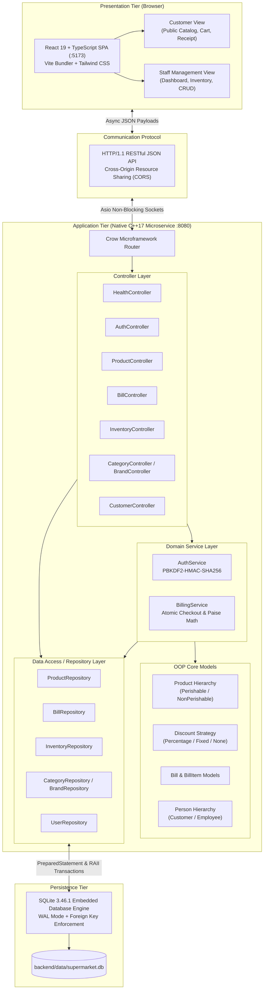
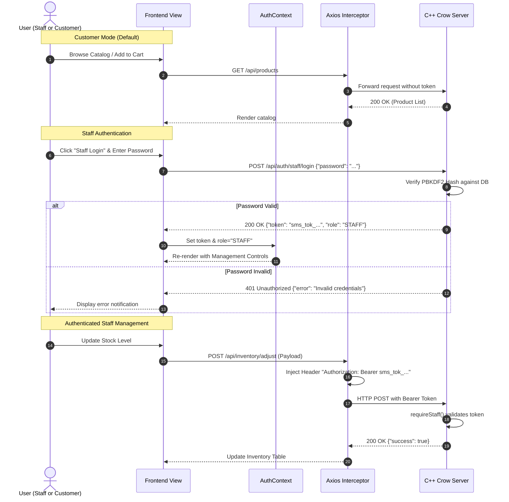
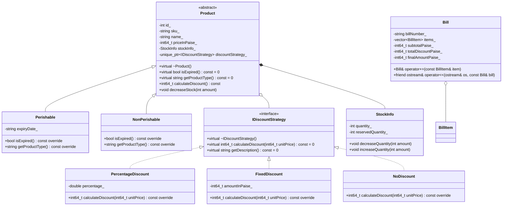

# System Architecture: Supermarket Billing & Inventory Management System

**Document Version:** 2.0
**Target Environment:** Windows 10/11 (MSVC C++17) & Linux Container (GCC/OpenSSL)
**Operating Architecture:** Two Operating Modes (Customer Mode & Staff Mode)

---

## 1. Architectural Overview

The **Supermarket Billing & Inventory Management System (ApexMart)** is organized as a decoupled, multi-tier client-server application. It decouples high-performance native server-side computation from a reactive, modern browser-based presentation layer.

---

## 2. Frontend Architecture (React 19 + TypeScript 5)

The frontend is architected as an asynchronous Single-Page Application (SPA) designed with strict TypeScript type contracts:

### 2.1 Component & Routing Hierarchy
- **`App.tsx`:** Defines application routing via `react-router-dom`:
  - `/`: Public customer-facing corporate home page and self-service purchasing portal.
  - `/staff` and `/dashboard`: Dedicated Staff operational dashboard.
  - `/billing`: High-speed Point-of-Sale (POS) terminal with reactive SKU search.
  - `/products`: Product catalog view and management.
  - `/inventory`: Inventory balance monitoring and stock adjustment ledger.
  - `/transactions`: Historical bill audit register and thermal receipt reproduction.
  - `/analytics`: Revenue metrics and sales category distributions.
  - `/admin`: Staff & system management (categories, brands, credentials, database metrics).
  - `/oop-concepts`: Interactive academic demonstration of C++ class hierarchies.
- **`Layout.tsx`:** Renders responsive dual-viewport layouts (collapsible desktop sidebar and responsive mobile header) with health indicators and user status badges.
- **`AuthContext.tsx`:** Centralized state tracking current operating mode (`'CUSTOMER' | 'STAFF'`), session token (`sms_staff_token`), and login/logout handlers.

### 2.2 Client-Side Security & State Flow

---

## 3. Backend Architecture (C++17 / Crow Microservice)

The backend is written in pure ISO C++17, adopting a high-performance modular pipeline:

### 3.1 HTTP Server & Network Layer
- **Crow Microframework (`v1.3.4`):** Provides zero-allocation URI routing, URL pattern matching, and HTTP verb dispatching.
- **Standalone Asio (`v1.30.2`):** Delivers asynchronous, non-blocking network socket handling via an event-driven I/O service.
- **CORS Middleware:** Injects appropriate HTTP response headers (`Access-Control-Allow-Origin: *`, `Access-Control-Allow-Methods`, `Access-Control-Allow-Headers`) to support cross-origin web client requests.

### 3.2 Controller Layer
Controllers are purely responsible for:
1. Parsing incoming JSON payloads via `nlohmann::json`.
2. Enforcing authentication boundaries via `requireStaff(req, authService)`.
3. Validating request parameter bounds (e.g., non-negative prices and positive quantities).
4. Invoking the appropriate Domain Service or Repository.
5. Serializing responses with standard HTTP status codes (`200 OK`, `201 Created`, `400 Bad Request`, `401 Unauthorized`, `404 Not Found`, `500 Internal Error`).

### 3.3 Domain Service Layer
- **`AuthService`:** Manages staff authentication lifecycles. Encapsulates PBKDF2-HMAC-SHA256 cryptography (using Windows CNG `<bcrypt.h>` on Windows or OpenSSL 3.x on Linux), salt generation, and in-memory session token tracking.
- **`BillingService`:** Encapsulates the core atomic checkout algorithm. Executes multi-item stock validation, applies polymorphic discount calculations in 64-bit integer paise, creates immutable invoice snapshots, decrements inventory, and logs audit movements inside a single atomic database transaction.

### 3.4 Data Access (Repository) Layer
Repositories encapsulate all SQL operations, ensuring domain logic never writes raw SQL queries:
- `ProductRepository`: CRUD queries, SKU uniqueness validation, active product filtering.
- `BillRepository`: Bill creation, snapshot insertion into `bill_items`, historical invoice queries, daily revenue aggregation.
- `InventoryRepository`: Low stock monitoring, inventory movement logging (`inventory_movements`), atomic stock adjustments.
- `CategoryRepository` & `BrandRepository`: Category and brand master data management, category-brand junction linking (`category_brands`).
- `UserRepository`: Staff credential retrieval and password hash updates.

---

## 4. C++ OOP Architecture & Design Patterns

The domain architecture serves as a textbook showcase of modern Object-Oriented design:

### Key Patterns:
1. **Strategy Pattern (`IDiscountStrategy`):** Decouples promotional calculation algorithms from product definitions, enabling dynamic runtime algorithm swaps.
2. **Repository Pattern:** Isolates domain models from SQLite storage queries, adhering to the Single Responsibility Principle (SRP).
3. **RAII (Resource Acquisition Is Initialization):**
   - `Transaction tx(conn);` ensures automatic rollback upon exceptions unless `tx.commit()` is explicitly reached.
   - `PreparedStatement stmt(conn, sql);` automatically finalizes SQLite statements upon leaving scope, preventing resource leaks.
   - `std::unique_ptr` guarantees deterministic memory cleanup for dynamically allocated discount strategies.

---

## 5. Transaction & Concurrency Model

The SQLite database operates in **Write-Ahead Logging (WAL)** mode (`PRAGMA journal_mode = WAL;`):
- **Concurrent Readers:** Unauthenticated customers browsing products read directly from shared memory without being blocked by checkout transactions.
- **Single Sequential Writer:** Write operations (checkouts, stock additions) are executed inside serialized ACID transactions.
- **Paise Currency Invariant:** Currency is strictly represented as an `INTEGER` of paise in SQLite. Floating-point division occurs only at display time in the browser UI, guaranteeing zero floating-point accumulation errors across thousands of sales.
