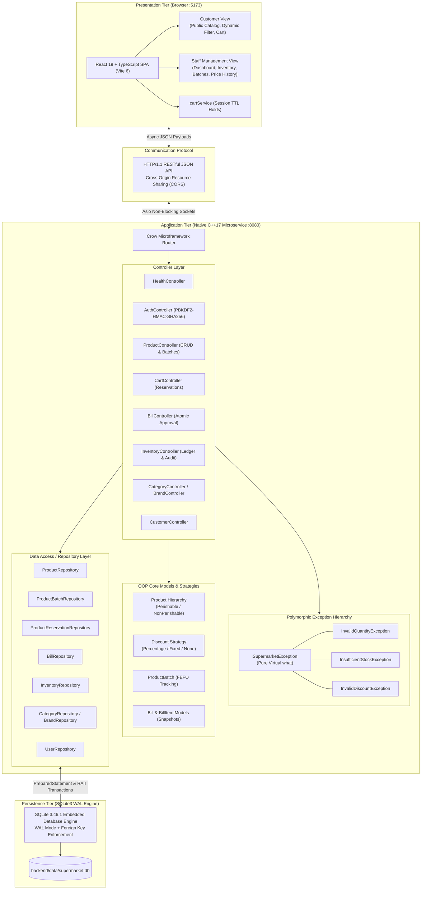
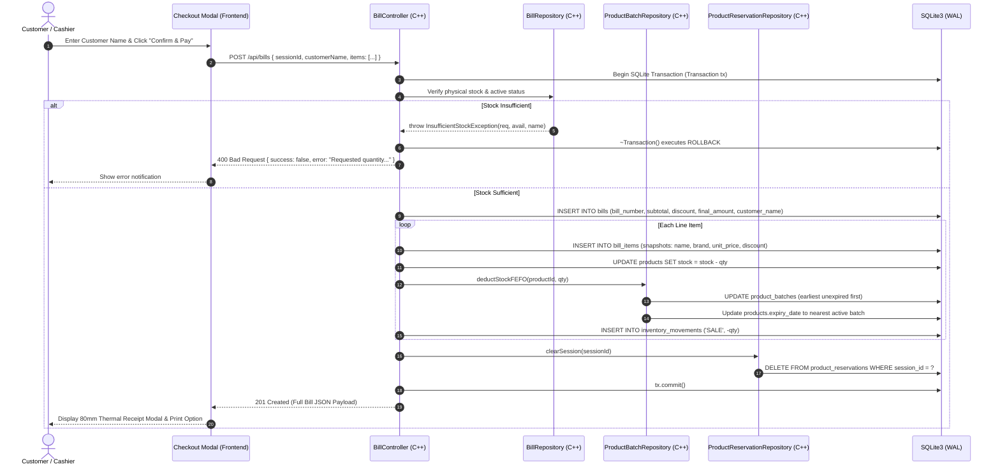

# System Architecture: Supermarket Billing & Inventory Management System (ApexMart)

**Document Version:** 3.0  
**Target Environment:** Windows 10/11 (MSVC C++17) & Linux Container (GCC/OpenSSL)  
**Operating Architecture:** Strict Two-Tier Mode Architecture (Customer Mode & Staff Mode)

---

## Table of Contents
1. [Architectural Overview](#1-architectural-overview)
2. [Multi-Tier System Topology](#2-multi-tier-system-topology)
3. [Purchase Approval & Confirmation Flow (Atomic Model)](#3-purchase-approval--confirmation-flow-atomic-model)
4. [Multi-Session Reserved Stock System](#4-multi-session-reserved-stock-system)
5. [Polymorphic C++ Domain Exception Architecture](#5-polymorphic-c-domain-exception-architecture)
6. [Inventory Management Enhancements & FEFO Pipeline](#6-inventory-management-enhancements--fefo-pipeline)
7. [Frontend Single-Page App Architecture](#7-frontend-single-page-app-architecture)
8. [Backend C++ Crow Microservice Pipeline](#8-backend-c-crow-microservice-pipeline)
9. [Concurrency, WAL Mode & ACID Persistence](#9-concurrency-wal-mode--acid-persistence)

---

## 1. Architectural Overview

The **Supermarket Billing & Inventory Management System (ApexMart)** is organized as an enterprise-grade, decoupled client-server application. It decouples high-performance native C++17 computation and embedded SQLite3 ACID persistence from a reactive, modern browser Single-Page Application (SPA) built with React 19, TypeScript 5, Tailwind CSS, and Vite.

### Core Architectural Guarantees:
1. **Integer Paise Financial Precision:** Every financial calculation in the system is executed using signed 64-bit integers (`int64_t`) representing paise ($1\text{ Rupee} = 100\text{ Paise}$). Floating-point values are never used for currency accumulation, completely preventing binary rounding drift.
2. **Atomic Purchase Approval Model:** The POS / self-checkout checkout operates as an atomic purchase approval model (no external payment gateway, no QR codes, no admin accept/decline bottleneck). Once confirmed, checkout immediately validates stock, records sales snapshots, deducts multi-batch inventory via FEFO, and emits immutable invoices inside a single SQLite transaction.
3. **Multi-Session Stock Isolation:** Dynamic cart stock reservations with a 15-minute TTL (`product_reservations`) prevent race conditions between concurrent shoppers.
4. **Strict Boundary & Exception Validations:** Negative and zero quantities are rejected with HTTP 400; discounts are strictly validated and unit prices are clamped never to fall below zero.

---

## 2. Multi-Tier System Topology



---

## 3. Purchase Approval & Confirmation Flow (Atomic Model)

In commercial retail supermarkets and modern self-service checkouts, customers and cashiers cannot be blocked by asynchronous third-party payment gateways, QR code scanning delays, or manual administrative approval bottlenecks.

### 3.1 Architecture & Flow
The system implements a direct **Atomic Purchase Approval Model**:
- When the customer or POS operator clicks **"Confirm & Pay"** or **"Checkout"**, the request is submitted via `POST /api/bills`.
- The backend Crow microservice processes the entire transaction atomically within an RAII SQLite database transaction:
  1. **Stock Verification:** Confirms that cumulative requested units for each item do not exceed live physical stock (`stock >= requested`). If insufficient, throws `InsufficientStockException` (HTTP 400).
  2. **Invoice Generation:** Creates a unique invoice number (`INV-YYYYMMDDHHMMSS-mmm-seq`).
  3. **Immutable Snapshot Creation:** Inserts lines into `bill_items` with historical snapshots of product name, brand name, unit price, applied discount type/value, and net line total.
  4. **Multi-Batch FEFO Stock Deduction:** Automatically dispatches stock reduction through `ProductBatchRepository::deductStockFEFO`, depleting the earliest expiring inventory batches first.
  5. **Movement Ledger Entry:** Records an immutable `SALE` movement in `inventory_movements` referencing the invoice ID.
  6. **Automatic Cart Release:** Clears any temporary reservation holds for the session in `product_reservations`.
  7. **Atomic Commit:** Calls `tx.commit()`.



---

## 4. Multi-Session Reserved Stock System

### 4.1 Problem Solved
In a retail or online ordering environment, multiple concurrent users may place scarce items into their shopping carts. Without a reservation system:
- User A and User B both see 2 units in stock.
- Both proceed to cart, but one experiences an unexpected failure at the last moment of payment.
- In uncoordinated systems, race conditions can even lead to negative inventory balances.

### 4.2 Architecture & Mechanics
1. **Persistent Reservation Table (`product_reservations`):**
   Stores active cart reservations with `session_id`, `product_id`, `quantity`, and Unix epoch `expires_at` (15-minute TTL).
2. **Dynamic Stock Calculation:**
   $$\text{reservedStock} = \sum_{\text{active holds}} \text{quantity}$$
   $$\text{availableStock} = \max\bigl(0,\, \text{totalStock} - \text{reservedStock}\bigr)$$
3. **Cart API Lifecycle:**
   - `POST /api/cart/reserve`: Adds or updates a reservation. If requested quantity exceeds available stock, rejects immediately with HTTP 409 Conflict.
   - `POST /api/cart/release`: Removes reservation for a specific product.
   - `POST /api/cart/clear`: Clears all holds for the session.
   - `GET /api/cart`: Returns active session holds with remaining TTL in seconds.
4. **Automatic Release on Checkout:**
   When `POST /api/bills` is invoked with `sessionId`, the reservations are automatically removed inside the checkout transaction.

---

## 5. Polymorphic C++ Domain Exception Architecture

The backend implements a dedicated OOP domain exception taxonomy in `backend/include/utils/Exceptions.hpp`:

```text
                     std::exception
                      ▲          ▲
                      │          │
        std::logic_error        std::runtime_error       ISupermarketException
              ▲                        ▲                  (Abstract Interface)
              │                        │                  [virtual what() = 0]
      std::invalid_argument            │                           ▲
         ▲              ▲              │                           │
         │              │              │                           │
         │   ┌──────────┴──────────────┼───────────────────────────┤
         │   │                         │                           │
         │   │              SupermarketException ──────────────────┘
         │   │
         │   └────── InvalidDiscountException ─────────────────────┐
         │                                                         │
         └────────── InvalidQuantityException ─────────────────────┤
                                                                   │
                            InsufficientStockException ────────────┘
```

- **`ISupermarketException`:** Pure virtual interface (`Abstraction`) ensuring all domain exceptions can be caught polymorphically.
- **Multiple Inheritance:** Derived classes inherit from standard STL exceptions (`std::invalid_argument`, `std::runtime_error`) for standard library interoperability while implementing `ISupermarketException`.
- **Encapsulation:** `InsufficientStockException` encapsulates `requested`, `available`, and `productName` behind public const getters: `.getRequested()`, `.getAvailable()`, `.getProductName()`.

---

## 6. Inventory Management Enhancements & FEFO Pipeline

### 6.1 Duplicate Item Restock Logic
When staff attempts to create a product via `POST /api/products`:
- System checks for an existing active product with identical SKU/barcode and normalized name/category.
- If found, rather than creating duplicate catalog records or rejecting the barcode, the backend automatically performs a **Restock**:
  - Increments existing stock by the requested quantity.
  - Appends a new batch record if perishable.
  - Logs an `ADDITION` movement in `inventory_movements`.
  - Returns HTTP 200: `"Existing item detected. Stock successfully increased by X units."`

### 6.2 Multi-Batch Tracking with FEFO Stock Deduction
- Table `product_batches` (Migration v5) stores individual shipment batches with `batch_number`, `quantity`, and `expiry_date`.
- During sales deductions (`POST /api/bills`), `ProductBatchRepository::deductStockFEFO()` executes a two-pass algorithm:
  - **Pass 1:** Depletes earliest-expiring **unexpired** batches first (`ORDER BY expiry_date ASC`).
  - **Pass 2 (Fallback):** If necessary, depletes remaining batches.
- **Nearest Expiry Synchronization:** Automatically updates the parent `products.expiry_date` column to reflect the earliest active batch.

### 6.3 Daily Price & Discount Auditing
- Table `price_history` (Migration v5) logs every modification to product prices or promotional discounts.
- Records `old_price_paise`, `new_price_paise`, `old_discount_type`, `new_discount_type`, `old_discount_value`, `new_discount_value`, and timestamps.

---

## 7. Frontend Single-Page App Architecture

Built with **React 19**, **TypeScript 5**, **Vite 6**, and **Tailwind CSS 3**:
- **Role-Based View Routing:**
  - Public Customer Mode: Corporate catalog discovery, search, dynamic category filtering ("All Categories" + categories), cart reservations, and self-service receipt generation.
  - Protected Staff Mode: Guarded by `StaffProtectedRoute.tsx`, authenticating against PBKDF2-HMAC-SHA256 (`Staff@123`).
- **Real-Time KPI Dashboard:**
  - Renders 5 core KPI cards: Today's Sales Revenue, Today's Invoices Count, Total Active Products, Low Stock Alerts, and Out of Stock Alerts.
  - Recharts visualizations for sales trends and category distributions.

---

## 8. Backend C++ Crow Microservice Pipeline

The Crow server processes requests through an optimized pipeline:
1. **Network Sockets (Standalone Asio v1.30.2):** Non-blocking event loop handles HTTP connections.
2. **CORS Middleware:** Validates origins, handles `OPTIONS` preflight requests, and injects cross-origin headers.
3. **Authentication Guard (`requireStaff`):** Verifies 64-character bearer tokens for staff-only endpoints.
4. **Controller Parameter Validation:** Strict bounds checks (positive quantities, valid discount bounds).
5. **Domain Processing & Exception Handling:** Translates domain exceptions into clean JSON error responses (`400 Bad Request`, `409 Conflict`).
6. **JSON Serialization (`nlohmann::json v3.11.3`):** Emits standard `ApiResponse<T>` envelopes.

---

## 9. Concurrency, WAL Mode & ACID Persistence

- **Write-Ahead Logging (WAL):** SQLite operates in WAL mode (`PRAGMA journal_mode = WAL;`), allowing infinite concurrent readers without blocking write transactions.
- **Transactional Integrity:** All multi-step write workflows utilize the RAII `Transaction` class. Stack unwinding guarantees automatic rollback if an exception is thrown before commit.
