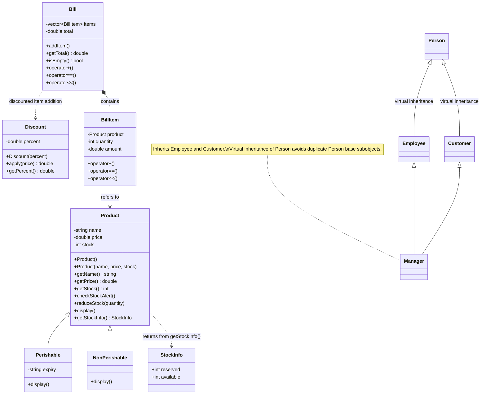
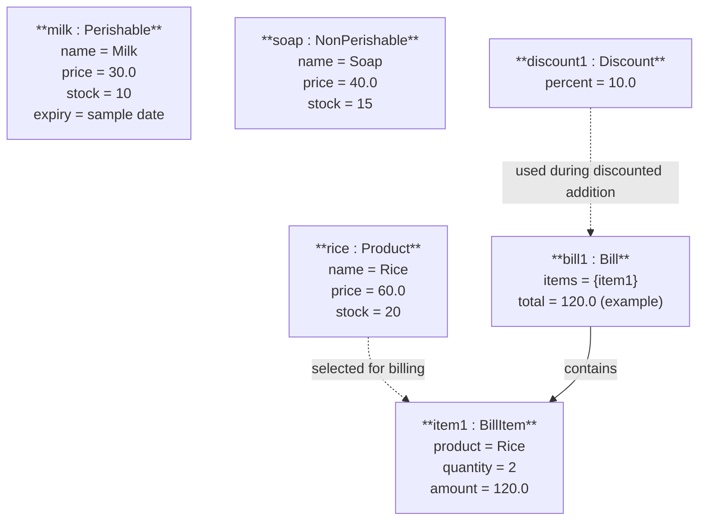
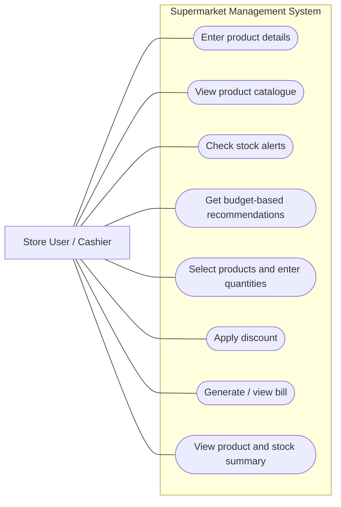

# Supermarket Management System — UML Diagrams

These diagrams are based on the project analysis document. GitHub renders the Mermaid diagrams automatically when they are placed inside Markdown files.

> **Note:** The object diagram uses illustrative sample values, not fixed values stored in the program.

## 1. UML Class Diagram

This diagram shows the main classes, inheritance, and important relationships.

## 2. UML Object Diagram

This is an example runtime snapshot showing sample products, a bill, a bill item, and a discount.

The values above are illustrative. Replace them with values from an actual program run if a runtime-specific object diagram is required.

## 3. UML Use-Case Diagram

The current application is a menu-driven console program. The diagram therefore uses one actor: **Store User / Cashier**.

## 4. CRC Summary

CRC means **Class–Responsibility–Collaborator**. This is included as a table because it is clearer and more readable than turning it into another relationship diagram.

| Class | Main responsibilities | Collaborators |
|---|---|---|
| `Product` | Store name, price and stock; provide getters; check low stock; safely reduce stock; display product; maintain counters. | `Perishable`, `NonPerishable`, `Bill`, `BillItem`, `main()` |
| `Perishable` | Represent a perishable product and display expiry information. | `Product`, `main()` |
| `NonPerishable` | Represent a non-perishable product and provide its display implementation. | `Product`, `main()` |
| `Discount` | Validate discount percentage and calculate discounted price. | `Bill`, `BillItem`, `main()` |
| `BillItem` | Represent one purchased line item and support its implemented operators. | `Product`, `Bill` |
| `Bill` | Store bill items; add normal/discounted items; calculate total; check empty state; maintain bill counter; support bill operators. | `BillItem`, `Product`, `Discount`, `main()` |
| `Person` | Common base type for the person inheritance demonstration. | `Employee`, `Customer` |
| `Employee` | Extend `Person` as an employee role. | `Person`, `Manager` |
| `Customer` | Extend `Person` as a customer role. | `Person`, `Manager` |
| `Manager` | Combine `Employee` and `Customer` through multiple inheritance. | `Employee`, `Customer`, `Person` |
| `Product::StockInfo` | Nested helper class for stock information returned by `Product::getStockInfo()`. | `Product` |

**Other program elements:** `recommendProducts()` filters available products by budget; `maxOf<T>()` is a function template; `Pair<T>` is a class template; `main()` coordinates input, menu actions, purchases, bill output and cleanup.

## 5. Noun–Verb Analysis

### Noun analysis

| Noun / phrase | Design result |
|---|---|
| Product | Class: `Product` |
| Perishable product | Derived class: `Perishable` |
| Non-perishable product | Derived class: `NonPerishable` |
| Discount | Class: `Discount` |
| Bill | Class: `Bill` |
| Bill item / quantity | Class: `BillItem`; quantity is item data |
| Person / Employee / Customer / Manager | Classes: `Person`, `Employee`, `Customer`, `Manager` |
| Stock information | Nested class: `Product::StockInfo` |
| Budget | Parameter to `recommendProducts()`; not a class |
| Catalogue / menu | Behaviour in `main()`; not a class |
| User / cashier | External actor in the use-case diagram |

### Verb analysis

| Verb | Mapped method / responsibility |
|---|---|
| Store / maintain | `Product` constructors and data members |
| Display / show | `Product::display()` and overridden `display()` methods |
| Check / alert | `Product::checkStockAlert()` |
| Reduce / update | `Product::reduceStock(quantity)` |
| Apply / calculate | `Discount::apply(price)`; `Bill::getTotal()` |
| Recommend / filter | `recommendProducts(products, n, budget)` |
| Add / compare | `Bill::addItem(...)`; overloaded `+` and `==` operators |
| Purchase / select | `main()`: select product, validate quantity and choose discount |
| Generate / print | Bill output and final bill summary |
| Inherit / specialize | `Perishable` and `NonPerishable` inherit `Product`; `Employee` and `Customer` virtually inherit `Person` |

---

## Accuracy notes

- The `Person` hierarchy and templates are OOP demonstrations; they are not directly part of the supermarket purchase workflow.
- The object diagram's names and values are examples only.
- The use-case diagram has one actor because the current console program does not implement separate login roles.
- The diagrams show the confirmed project structure and avoid inventing unavailable private fields or exact method signatures.
